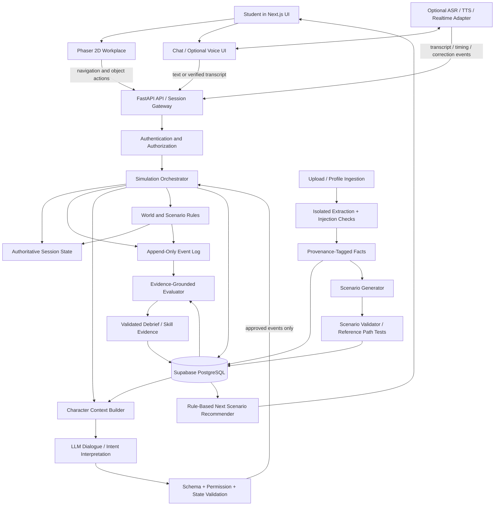

# WorkVerse AI — Advanced Research Report

**Topics:** Procedural scenario validity; multi-agent coordination; adaptive difficulty and skill mastery; fair AI assessment; real-time voice interaction; profile grounding and document ingestion; skill transfer and long-term learning.  
**Prepared:** 10 October 2026  
**Research status:** Evidence-informed design report, not a claim that WorkVerse AI has already been experimentally validated.

> **How to read this report.** Each numbered subsection has five explicitly labeled outputs: research findings, comparative analysis, implications for WorkVerse AI, risks and open questions, and recommended actions. The report separates published evidence from engineering inference. Results from medicine, general education, speech recognition, and game generation are useful analogues, but they do not automatically prove that the same effects will hold for software-workplace simulation.

## Executive summary

WorkVerse AI should be treated as a **stateful training-and-assessment system with a 2D interface**, not as a collection of autonomous chatbots inside an office. The strongest architecture is hybrid: structured scenario blueprints and deterministic rules constrain the simulation; LLMs interpret natural-language intent and produce character dialogue; the backend validates consequential actions; and a separately defined evaluator scores observable evidence against a rubric.

The six advanced topics are interdependent:

1. **Procedural scenario generation** creates variation, but variation must preserve learning objectives, solution paths, information availability, and assessment comparability.
2. **Multi-agent coordination** makes the office feel socially credible, but independent characters need controlled knowledge and a shared authoritative world state to avoid contradictions.
3. **Adaptive difficulty** can personalize practice, but the system should estimate skill from repeated evidence—not infer mastery from a single score, response length, or self-reported experience.
4. **Fair assessment** requires evidence traceability, rubric anchors, paraphrase tests, language-style audits, and a way to correct speech-recognition errors before they affect scores.
5. **Voice interaction** adds conversational richness but introduces recognition errors, turn-taking complexity, latency, accessibility concerns, and extra cost. It should share the same event model as text.
6. **Profile grounding and learning-transfer measurement** make scenarios relevant and test whether practice generalizes, but they require provenance, privacy controls, unseen-scenario testing, and delayed follow-up.

A practical first version should use validated scenario templates with bounded parameter variations, a central simulation service, three or fewer character roles, an event log, a transparent rubric, and text interaction. A simple rules-based difficulty policy is sufficient at first. Voice, complex agent-to-agent planning, psychometric calibration, and large-scale longitudinal studies are valuable later steps.

The report recommends testing three candidate technical contributions:

- **Constraint-validated personalized scenario generation** that changes scenario surface details while keeping objectives and valid resolution paths stable.
- **Authoritative shared-state workplace simulation** with character-specific knowledge and auditable communication.
- **Evidence-grounded, fairness-tested evaluation** whose scores link to transcript turns and task events and are tested for paraphrase stability.

These are promising contributions, not guaranteed research novelties. A prior-art search and controlled evaluation would be required before claiming novelty or effectiveness.

---

# Part 6 — Procedural Scenario Generation with Validity Guarantees

## 6.1 Research landscape and approaches

### Output — Research findings

Procedural content generation (PCG) studies how to produce content algorithmically rather than authoring every instance manually. In games, generated content may be cosmetic, structural, or functional; functional content must support coherent play, not simply look plausible. Summerville et al.'s PCGML survey distinguishes learned generation from constructive, search-based, and solver-based approaches and highlights the importance of content representation, data limitations, and evaluation ([PCGML survey, IEEE Transactions on Games, 2018](https://doi.org/10.1109/TG.2018.2846639)). For WorkVerse, a scenario is functional content: it contains objectives, people, constraints, information, actions, and consequences. Linguistically convincing text is not sufficient if the task cannot be completed or the rubric cannot observe the required behavior.

A useful distinction is between **generation** and **validation**. An LLM can draft an incident narrative, but independent checks must establish whether required facts exist, dependencies are consistent, and a valid path to completion remains available. Evidence from clinical scenario-generation research demonstrates the general pattern: ChatGPT can produce realistic drafts quickly, but expert reviewers identified meaningful inconsistencies, omissions, and errors that required refinement ([Ghaffari et al., clinical scenario generation study, 2025](https://pmc.ncbi.nlm.nih.gov/articles/PMC12145122/)). This is not direct evidence about software-workplace tasks, but it is a relevant warning against treating fluent generation as proof of validity.

Three broad families are useful:

- **Constructive/parameterized generation:** A human-designed template contains slots and constraints; a generator selects allowed values.
- **Search- or solver-based generation:** A candidate is produced or searched for against explicit constraints, objectives, or fitness functions.
- **Model-based generation:** An LLM or learned model drafts scenarios, potentially followed by deterministic and model-assisted checks.

The best fit is usually a hybrid: authored competency templates and rules define what must remain true; a generative model varies the narrative, supporting details, and dialogue; validators reject or repair invalid instances.

### Output — Comparative analysis

| Approach | Strengths | Weaknesses | WorkVerse fit |
|---|---|---|---|
| Hand-authored scenarios | Strong control; easy to inspect and test | Expensive to scale; repetitions become obvious | Essential seed set and gold-standard cases |
| Parameterized templates | Predictable and testable; clear variation bounds | Can feel formulaic; requires domain modeling | Best MVP foundation |
| Constraint/solver-based generation | Can verify formal properties when the domain is formalized | Modeling all workplace semantics is difficult; solver success proves only encoded constraints | Use for dependencies, time windows, required evidence and action preconditions |
| LLM-only generation | Flexible, fast, can produce natural context | May omit facts, contradict itself, drift in difficulty, or generate unscorable events | Do not trust as a publishing gate by itself |
| Hybrid generation and validation | Balances variety with control | More engineering and testing required | Recommended target architecture |

### Output — Implications for WorkVerse AI

Every scenario instance should be produced from a **versioned blueprint**, not a free-form opening prompt. The blueprint should define target competencies, scenario family, starting conditions, required facts, role-specific knowledge, available actions, event rules, completion criteria, failure conditions, and rubric links. Generated prose should describe those facts, not silently redefine them.

A production incident template might keep the primary competency fixed—risk-aware incident response—while varying root cause (configuration regression, incompatible migration, dependency outage), severity, stakeholder urgency, and evidence location. The underlying assessment should still test impact assessment, evidence gathering, safe mitigation, and communication. If a variation removes the possibility of gathering evidence, then the objective and rubric are no longer comparable and the instance should be rejected or assigned a different rubric.

### Output — Risks and open questions

- **Natural-language constraints are difficult to formalize.** A deadline can be syntactically valid yet operationally impossible because of hidden dependencies.
- **Passing a simulated solve test is not a guarantee.** A strong agent may solve a scenario by exploiting knowledge that a student cannot reasonably discover.
- **Difficulty is user-dependent.** A task easy for an experienced backend developer may be hard for a beginner; objective labels alone do not establish equivalence.
- **Validation can overfit.** A generator may learn to pass checks without creating meaningful variety.
- **There is limited direct evidence** on automatic validity guarantees for LLM-generated software workplace simulations. Claims must remain hypotheses until WorkVerse evaluates its own output.

### Output — Recommended actions

**MVP:** Use 2–3 manually reviewed scenario families, each with bounded parameter slots. Require schema validation, rule checks, and a successful reference resolution path before a scenario can run. Store the exact scenario version with each session.

**Later:** Add solver-based planning for complex dependencies, model-assisted critique, difficulty-equivalence studies, automated test-case generation, and expert-review queues. Treat LLM critique as one signal, never the only gate.

---

## 6.2 Preserving learning objectives across scenario variants

### Output — Research findings

The core requirement is **construct preservation**: two variants should present different surface details while eliciting evidence about the same underlying competency. Evidence-centered design (ECD) in assessment begins by specifying the knowledge or skill being measured, what observable evidence would support a claim about that skill, and what tasks are likely to elicit that evidence. Mislevy and colleagues describe this as an evidentiary argument connecting claims, evidence, tasks, and measurement models ([Mislevy & Haertel, “Implications of Evidence-Centered Design for Educational Testing”](https://doi.org/10.1111/j.1745-3992.2006.00075.x)). This framework applies directly to scenario design: a task should be created from the evidence it needs to reveal, not merely from a story that sounds realistic.

For example, the claim “the learner handles incidents responsibly” is too broad to score directly. It must be decomposed into observable behaviors such as checking customer impact, consulting recent logs, considering rollback compatibility, proposing a mitigation, and committing to a defined stakeholder update. Scenario variants should preserve the opportunity to display those behaviors, even if the technical cause and character dialogue differ.

A scenario generator should therefore separate:

1. **Invariant learning objective:** what competency must be practised.
2. **Required evidence opportunities:** the decisions or actions through which competency can be observed.
3. **Variable scenario parameters:** details that may safely differ.
4. **Forbidden transformations:** changes that remove evidence opportunities or change the target competency.
5. **Rubric mapping:** which evidence supports which criterion.

### Output — Comparative analysis

| Variation method | Objective preservation risk | Recommended use |
|---|---|---|
| Change names, room, product label | Low if irrelevant to the task | Cosmetic variation; insufficient alone for replayability |
| Change root cause while retaining key decisions | Medium; requires technical review | Good for technical scenario families |
| Change stakeholder urgency/personality | Medium; may alter communication burden | Use controlled behavior profiles |
| Change required competencies | High; changes the assessment construct | Treat as a different scenario family/rubric |
| Free-form regeneration of everything | Very high | Avoid for scored sessions until rigorously validated |

### Output — Implications for WorkVerse AI

Each scenario family needs an **objective contract**. The contract should say what the learner must be able to demonstrate, what information must be discoverable, what actions are possible, which outcomes are acceptable, and which rubric criteria are assessable. Generation can vary details only inside the contract.

A concrete invariant for an incident-response family might be: “Before selecting a high-impact mitigation, the learner has a reasonable opportunity to inspect evidence or explicitly communicate uncertainty.” A variant that allows no evidence access violates the contract. A scenario in which the correct answer is “roll back immediately” regardless of context may measure recall, not risk assessment.

### Output — Risks and open questions

- **Objective drift can be subtle:** a changed dependency may make one variant fundamentally easier or more ambiguous.
- **Over-constrained templates reduce realism:** too few variables create visible repetition.
- **Rubric drift creates unfair comparisons:** the evaluator may score behaviors that were not possible in a particular variant.
- **Profile personalization can alter the construct:** giving a learner the exact technology they already know may make a supposedly general problem-solving scenario easier.

### Output — Recommended actions

**MVP:** Define each scenario as a competency contract plus template. Add automated checks that every required rubric criterion has at least one plausible evidence opportunity. During authoring, maintain a reference solution and a short “why this measures the same skill” note for each variation.

**Later:** Add expert review of variant pairs and run equivalence analyses using real learner data. Track scenario parameters and rubric versions so apparent progress is not caused by easier generated variants.

---

## 6.3 Discoverability, solvability, and contradiction detection

### Output — Research findings

A scenario can be validly structured yet educationally unfair if the learner cannot discover the information needed to make a reasonable decision. Validation should cover both **state validity** and **epistemic validity**: state validity asks whether facts, dependencies, actions, and timelines are internally consistent; epistemic validity asks whether the learner can discover required facts through realistic, available interactions.

Procedural simulation practice in autonomous driving provides a relevant engineering analogue. Aurora describes using procedural “recipes” and cascading rules and filters to generate broad scenario coverage rather than manually authoring every scenario ([Aurora, “Scaling Simulation”](https://aurora.tech/newsroom/scaling-simulation/)). In WorkVerse, the equivalent is to define what an incident entails and then filter generated variations based on preconditions and test results. The analogy supports a pipeline pattern, not a claim that workplace scenarios can be validated with the same rules as driving simulation.

A strong validator should check at least four layers:

1. **Schema validity:** required fields, valid references, unique IDs, supported event types.
2. **Constraint validity:** deadlines, dependencies, resource availability, allowed actions, role permissions.
3. **Information availability:** every critical fact is exposed through a plausible source, person, document, or tool; reveal conditions are reachable.
4. **Reachability/solvability:** at least one sequence of permitted actions can achieve the goal or a defined graceful failure/mitigation state.

### Output — Comparative analysis

- **Static rules** are fast, deterministic, and explainable, but detect only problems encoded by developers.
- **Graph reachability/planning** can verify that actions form a path to an objective when the state/action space is explicit.
- **LLM critique** can identify natural-language contradictions and implausible character motivations, but can miss errors or invent them.
- **Simulation-based testing** can reveal dead ends and bad transitions, but depends on the quality and diversity of test agents.
- **Human review** is expensive but important for realism, fairness, and domain correctness.

These methods are complementary. An LLM should not be permitted to declare its own output “valid” without independent checks.

### Output — Implications for WorkVerse AI

For each key scenario, maintain an **information availability graph**. Nodes represent facts or artifacts; edges represent ways the learner can discover them—for example, asking an engineer, opening deployment logs, checking a status dashboard, or reading a migration note. The validator should verify that critical evidence is reachable without relying on hidden narrator knowledge.

Also define explicit deadlines as scenario mechanics rather than prose only. If the manager says “we have five minutes,” the simulation must specify what expires after five minutes and whether the learner has enough action opportunities to respond. “Impossible” should be judged relative to allowed actions and the scenario’s intended level of urgency, not merely by a number in a paragraph.

### Output — Risks and open questions

- A solver may exploit unrealistic actions (e.g., inspect internal admin tools without authorization).
- Contradictions may exist in dialogue semantics rather than structured fields.
- A scenario may be solvable by one strategy but still fail to support alternative competent strategies.
- Simulated agents may systematically behave more helpfully than realistic colleagues, creating false discoverability.
- Fully formalizing a workplace world is impractical; some validation will remain probabilistic or human-reviewed.

### Output — Recommended actions

**MVP validation gate:**

1. Validate the schema with Pydantic.
2. Validate graph references and allowed transitions.
3. Run deadline, dependency, and required-fact checks.
4. Execute one authored reference path using deterministic test actions.
5. Run adversarial/playtest scripts that omit key questions, make a bad decision, or request an unavailable action.
6. Publish only if mandatory checks pass; send uncertain cases to manual review.

Record each validator result, scenario version, and rejection reason. This makes the validation pipeline itself testable and auditable.

---

## 6.4 Difficulty equivalence and scoring consistency

### Output — Research findings

Two scenarios are not equivalent merely because they share a label such as “medium.” Difficulty can be influenced by the number of facts, ambiguity, working-memory demands, time pressure, stakeholder resistance, technical prerequisite knowledge, and the number of decisions that must be coordinated. In psychometrics, Item Response Theory and computerized adaptive testing use calibrated task characteristics and observed responses to estimate proficiency and select informative tasks; however, open-ended workplace simulations are richer than conventional test items and cannot inherit IRT validity automatically. The Educational Testing Service describes adaptive testing as selecting subsequent items based on updated estimates, with content balancing and item-pool quality as important operational issues ([ETS, adaptive testing overview](https://www.ets.org/research/policy_research_reports/publications/chapter/2025/khjj.html)).

For WorkVerse, comparability should initially be treated as an empirical question. Use design-level controls first, then collect data to test whether variants actually behave similarly for comparable learners. An “ideal agent solved both in six steps” test is useful for finding gross defects but not enough to establish human difficulty equivalence.

### Output — Comparative analysis

| Method | What it tells you | Main limitation |
|---|---|---|
| Parameter matching | Whether intended difficulty factors are controlled | Factors may not predict actual learner difficulty |
| Expert rating | Whether domain experts consider variants comparable | Raters can disagree; experts may not represent novice learners |
| Reference-agent solve tests | Whether one chosen strategy can solve variants | Model behavior is not a human learner baseline |
| Pilot learner performance | Empirical difficulty and score distributions | Needs enough representative users and careful controls |
| Psychometric calibration | Estimates relationships among task difficulty and learner ability | Needs an adequate pool, sample size, assumptions, and comparable constructs |

### Output — Implications for WorkVerse AI

Tag each scenario with difficulty features: prerequisite load, number of relevant facts, number of stakeholders, time pressure, ambiguity, dependency depth, risk severity, and permitted hints. Freeze the scoring rubric across variants that claim to assess the same construct. Where a variant makes a criterion impossible to observe, either reject it or change its rubric and do not compare scores as if they were equivalent.

At first, report progress by **competency and evidence trend**, not as an overconfident universal skill number. Once enough data exists, investigate calibration methods such as IRT-style models or hierarchical models that account for both learner and scenario variation.

### Output — Risks and open questions

- A small pilot cannot reliably estimate item difficulty for many variant types.
- Learners may have different prior knowledge despite similar profile labels.
- Scores can change because the evaluator or model version changed, not because the learner changed.
- Adaptive selection can cause curriculum gaps if the system repeatedly avoids weaknesses or over-practises one competency.

### Output — Recommended actions

**MVP:** Use bounded difficulty levels and deterministic features; keep rubrics and core decisions aligned; compare variants in structured expert review; avoid claims of psychometric equivalence.

**Later:** Run pilot studies, estimate item/variant difficulty, analyze score distributions and criterion-level agreement, check differential performance across relevant learner groups, and only then create calibrated difficulty bands.

---

## 6.5 Proposed validation pipeline and scenario blueprint

### Output — Research findings

A staged validation approach is more robust than asking a single model to generate and approve an entire scenario. The general PCG literature supports separating content representation, generation, critique, and evaluation; the clinical scenario study cited above likewise shows why fast generation still needs systematic review ([PCGML survey](https://doi.org/10.1109/TG.2018.2846639), [clinical scenario-generation study](https://pmc.ncbi.nlm.nih.gov/articles/PMC12145122/)).

A suitable blueprint has the following logical groups:

```yaml
scenario_id: incident-deployment-variant-042
scenario_version: 1
scenario_family: production_incident
role_target: junior_backend_engineer
learning_objectives:
  - assess_customer_impact
  - gather_relevant_evidence
  - choose_safe_mitigation
  - communicate_uncertainty_and_next_update
initial_state:
  incident_severity: high
  customer_impact: checkout_failures
  deploy_age_minutes: 8
characters:
  - id: manager
    role: engineering_manager
    goals: [restore_service, obtain_clear_updates]
    private_facts: [release_deadline]
  - id: teammate
    role: backend_engineer
    goals: [help_diagnosis]
    private_facts: [migration_warning]
required_information:
  - fact: migration_warning
    discoverable_via: [ask_teammate, inspect_deployment_notes]
actions:
  - inspect_logs
  - check_error_rate
  - propose_rollback
  - communicate_status
completion_conditions:
  - mitigation_selected_or_risk_communicated
  - stakeholder_update_provided
rubric_version: incident-rubric-v1
validation:
  schema: required
  constraints: required
  reference_path: required
  adversarial_tests: required
```

This is illustrative, not a final database schema. Sensitive fields such as private character facts should be explicit and controlled by server-side logic.

### Output — Comparative analysis

A practical pipeline is:

1. Select a validated scenario family and objective contract.
2. Choose parameter values from allowed ranges.
3. Generate narrative details and character phrasing.
4. Parse the result into a strict schema.
5. Run rule, graph, dependency, privacy, and rubric checks.
6. Test a reference solution and adversarial paths.
7. Compare variant features against the target difficulty band.
8. Mark as accepted, rejected, or requiring human review.
9. Freeze the resulting scenario version for the session.

A repair loop can ask a model to fix a narrowly specified validation failure, but the corrected candidate must rerun the full gate. Do not let repeated repair loops continue indefinitely or bypass failed conditions.

### Output — Implications for WorkVerse AI

FastAPI can expose scenario generation as an explicit service boundary. Pydantic models validate the blueprint; deterministic Python code checks constraints and transitions; the LLM only fills bounded narrative and dialogue fields. Supabase PostgreSQL stores template versions, generated scenario versions, validation reports, and session references. The browser receives only the scenario information required for rendering—not private facts or the answer key.

### Output — Risks and open questions

Validation logic can become harder to maintain than the generator if rules are not modular. Too many automatically generated scenarios can also make debugging difficult. Scenario versions, seeds, model versions, prompts, validator versions, and rubric versions must be recorded to reproduce a failed session. Human review thresholds need to be based on risk and uncertainty rather than convenience.

### Output — Recommended actions

Implement the pipeline with one family first. Save accepted and rejected generations and their failure reasons. Turn each real failure found in playtesting into a regression test. Require explicit validation of the reference path and information discoverability before exposing a scenario to students.

---

## 6.6 Evaluation metrics, experiments, risks, and recommendations

### Output — Research findings

A scenario generator needs a test suite for **validity, diversity, usefulness, and comparability**. Surface-level plausibility ratings alone are insufficient. Metrics should map to specific claims: schema pass rate tests structural quality; contradiction count tests consistency; objective coverage tests alignment; path reachability tests solvability; parameter distance or human ratings test diversity; and learner performance data supports empirical difficulty comparisons.

The test dataset should include both normal cases and intentionally corrupted cases—missing evidence, impossible dependencies, incompatible migration assumptions, unreachable rooms, duplicate events, or conflicting role knowledge. A validator that only sees well-formed generated outputs can appear effective while failing on the defects it is supposed to catch.

### Output — Comparative analysis

| Metric | Method | Interpretation |
|---|---|---|
| Schema pass rate | Programmatic validation | Basic syntactic/structural validity only |
| Constraint violation rate | Rule checker | Detects encoded inconsistencies |
| Objective coverage | Map rubric criteria to evidence opportunities | Tests whether criteria are observable |
| Solvability rate | Graph search/reference path/playthrough | Indicates at least one modeled path exists |
| Discoverability rate | Check reachable sources for required facts | Detects hidden or inaccessible information |
| Diversity | Parameter distribution plus expert judgment | Must distinguish meaningful from cosmetic variety |
| Difficulty comparability | Learner scores and completion behavior across variants | Requires data; not proven by model-only tests |
| Human revision rate | Expert review logs | Helps locate weak generation/validation stages |

### Output — Implications for WorkVerse AI

Create a benchmark of authored base scenarios and deliberately broken variants. Measure validator precision and recall where the defect labels are known. A false accept is often more costly than a false reject for a scored scenario, although over-rejection may make the platform too repetitive. Track both. Evaluate how often human reviewers must correct content and whether repairs preserve the objective contract.

### Output — Risks and open questions

The number of unique variants may be a misleading success metric. More generated content is not valuable if the scenarios are repetitive in decisions or differ in difficulty. Test agents can be exploited by generators, so include multiple strategies and occasional human playtests. Do not describe a validator as providing “guarantees” unless the guarantee is formal and limited to clearly stated properties.

### Output — Recommended actions

**Initial experiment:** Generate a small set of variants for one incident family, inject labeled defects, and compare three pipelines: no validation, deterministic validation only, and deterministic plus LLM critique/playtest. Have a domain reviewer label the accepted outputs. Report defect detection, false rejection, review time, and cost.

**MVP gate:** No scenario reaches a scored session without passing schema, constraint, required-information, rubric-coverage, and reference-path checks. Continue manual playtesting until false-accept risk is understood.

### Part 6 synthesis

- **Strongest conclusion:** Generation and validation should be separate processes. A plausible narrative is not proof that a scenario is solvable or fair.
- **Recommended design:** Bounded templates + structured blueprint + deterministic checks + reference-path testing + risk-based human review.
- **Most uncertain issue:** Empirical equivalence of generated variants for different learners. This requires user data and careful evaluation.
- **Research opportunity:** A measurable pipeline that preserves objective contracts and reports its detected defect types, not merely a prompt that produces scenarios.

---

# Part 7 — Multi-Agent Coordination and Believable Virtual Colleagues

## 7.1 Research landscape and architecture patterns

### Output — Research findings

The *Generative Agents* paper by Park et al. proposes agents that store experiences in a memory stream, retrieve relevant memories based on relevance, recency, and importance, reflect on experiences, and plan actions. In a sandbox with 25 agents, the authors demonstrate believable individual and emergent social behavior, while ablations show that observation, planning, and reflection each contribute to behavior quality ([Park et al., UIST 2023](https://doi.org/10.1145/3586183.3606763), [arXiv version](https://arxiv.org/abs/2304.03442)). The paper is directly relevant to character memory and social simulation, but it does not establish that unstructured autonomous agents are reliable enough for scored workplace assessment.

Common coordination patterns include:

- **Single agent with role context:** one model plays a selected character per turn.
- **Central supervisor:** a coordinator routes requests, controls state, and invokes specialized characters or tools.
- **Shared blackboard/state:** agents read permitted views of a common world state and publish events or messages through a controlled service.
- **Peer-to-peer:** agents communicate directly and negotiate without a single central decision maker.
- **Hybrid:** centralized authority for world state and action validation, with limited autonomous character-to-character communication mediated through an event bus.

For WorkVerse, the primary challenge is not the number of agents; it is ensuring that each character has plausible knowledge, stable motivations, and no ability to rewrite reality or the assessment rules.

### Output — Comparative analysis

| Pattern | Coherence/control | Realism/flexibility | Cost/complexity | MVP fit |
|---|---|---|---|---|
| One agent changes role prompts | Moderate; memory can leak across roles if poorly separated | Adequate for simple roleplay | Low | Good for prototype if contexts are isolated |
| Supervisor + role-specific agents | High if coordinator owns the state | High flexibility | Medium/high; more calls and orchestration | Good later; useful if two or three roles have distinct needs |
| Shared blackboard/event bus | Strong auditability; access control explicit | Good if agents can act on scoped views | Medium | Recommended core pattern |
| Full peer-to-peer agents | Distributed and emergent | Potentially realistic | High coordination and debugging burden | Not recommended for MVP |

### Output — Implications for WorkVerse AI

Use the **simulation engine as the authority**. Characters can propose speech and suggest actions, but only the engine may commit state changes. The manager, teammate, and client should be role configurations over controlled agent execution, not completely autonomous services with unrestricted database access.

Each character should have a role card: goals, allowed knowledge, stable personality/communication traits, authority, escalation triggers, and forbidden claims. Dialogue generation should receive the character’s allowed knowledge view plus relevant recent events. It should not receive the complete answer key or another character’s private facts unless those facts have been shared through an authorized event.

### Output — Risks and open questions

- The Generative Agents findings arise from a specific sandbox and do not prove workplace realism or accurate assessment.
- More agents can increase latency, cost, and cross-character contradictions.
- Role prompt separation alone is not a security boundary if agents share an unrestricted context or tools.
- Conflicts can become melodramatic or arbitrary if motivations are only textual rather than linked to state and incentives.

### Output — Recommended actions

**MVP:** Implement one FastAPI orchestration service, a shared session-state object, role-specific context builders, and one agent response at a time. Log every character message and every committed world event.

**Later:** Compare single-model role switching against separate character agents using the same scripted test set. Add agent-to-agent negotiation only when the learning objective needs it.

---

## 7.2 Shared world state, character knowledge, and information flow

### Output — Research findings

A consistent simulation must distinguish **truth in the scenario** from **what a character knows** and **what the learner has discovered**. These are three separate state layers:

1. **Authoritative world state:** what objectively happened in the simulated environment.
2. **Character knowledge state:** facts known, believed, suspected, or unknown to each virtual colleague.
3. **Learner-visible state:** facts and artifacts the student has accessed or been told.

The memory and retrieval mechanisms described by Park et al. show why preserving individual experience matters for agent behavior, while their reported failures include missing relevant memories and fabricated embellishments ([Generative Agents](https://arxiv.org/abs/2304.03442)). For WorkVerse, explicit fact provenance and scoped knowledge are needed in addition to natural-language memory.

A character should not automatically know what another character said privately. Knowledge can spread through a meeting, a message, a shared document, an observed action, or a deliberate disclosure event. Character beliefs may be wrong, but the underlying world state should not change just because a character claims it has changed.

### Output — Comparative analysis

- **One shared transcript for all agents:** easy to implement, but unrealistic and prone to private-information leakage.
- **Separate memories with no sharing rules:** preserves privacy, but agents may fail to coordinate or remember shared commitments.
- **Shared facts with explicit visibility labels:** more work, but offers a practical middle ground.
- **Natural-language agent-to-agent communication only:** realistic but difficult to audit and can silently alter interpretation.
- **Typed events plus natural-language dialogue:** dialogue remains human-like while state transfer is explicit and testable.

### Output — Implications for WorkVerse AI

Represent knowledge as facts with a source and visibility scope. Useful fields include `fact_id`, `value`, `source_event_id`, `known_by_character_ids`, `visible_to_learner`, `confidence_or_status`, and `valid_from_event`. A simple MVP may use relational rows or structured JSONB rather than a sophisticated knowledge graph.

For example, the teammate may know that a migration changed a column type. The learner does not know this until they ask the teammate or inspect deployment notes. If the student shares the finding with the manager, the engine records a disclosure event so the manager can refer to it later. The manager may still have a separate private deadline constraint, but that does not authorize the manager to invent database facts.

### Output — Risks and open questions

- **Knowledge leakage:** private facts appear in another character’s reply or in a visible object prematurely.
- **Stale beliefs:** a character continues to act on a fact that the world state has invalidated.
- **Ambiguous beliefs:** a character’s suspicion may be mistaken for confirmed truth.
- **State explosion:** tracking every belief in detail can be expensive and hard to maintain.

### Output — Recommended actions

**MVP:** Use a shared event log, explicit character-scoped fact sets, and three knowledge statuses: known, suspected, and unknown. All disclosure happens through recorded events. Validate every character response against permitted facts and key invariants in test runs.

**Later:** Add belief updates, confidence models, memory retrieval, and character-specific reflection if evaluations show that simple facts and recent event context are insufficient.

---

## 7.3 Conflicting goals, realistic behavior, and consistency

### Output — Research findings

Believable characters require more than a persona adjective such as “impatient” or “friendly.” Their behavior should follow stable objectives, incentives, role permissions, prior commitments, and information. Conflicting goals create useful workplace tension: a client may prioritize delivery date, an engineering manager may balance reliability and customer impact, and a teammate may prioritize technical correctness. Such conflict should remain bounded by the scenario’s shared facts.

The *Generative Agents* paper illustrates planning and memory as ingredients in believable behavior, but also identifies errors such as failed retrieval and embellished memories. This matters because a character can sound convincing while being factually inconsistent. Character realism should therefore be evaluated separately from factual/state consistency.

### Output — Comparative analysis

| Character design | Benefit | Risk |
|---|---|---|
| Personality traits only | Simple and cheap | Clichéd dialogue; little behavioral grounding |
| Goals plus constraints | Actions are explainable and tied to the task | Requires explicit goal-conflict design |
| Memory + goals + planning | Greater continuity and initiative | More latency, state complexity, and possible fabricated memory |
| Scripted branches | Highly controllable | Less flexible; repetitive |
| Bounded generative behavior | Natural conversation with controlled consequences | Requires validators and testing |

### Output — Implications for WorkVerse AI

Define character behavior in terms of **goals, constraints, and permitted actions**, then let an LLM realize those motivations through natural speech. For example, a manager should request a clear status update when incident risk rises; a defensive reviewer should react to criticism more strongly than to evidence-based and respectful explanations. Those reactions should influence communication and trust, not arbitrarily alter objective technical facts.

Keep social consequences interpretable. The student should be able to understand why a stakeholder became concerned—e.g., a promised update was missed—rather than being punished by a random mood change.

### Output — Risks and open questions

- Overly scripted character behavior feels artificial.
- Overly unconstrained goals can distract from learning objectives.
- “Realistic conflict” can reproduce stereotypes or abusive behavior.
- It is difficult to measure realism objectively; self-reported immersion alone is not enough.

### Output — Recommended actions

**MVP:** Give each character two or three explicit goals, a bounded set of triggers, a tone profile, and allowed facts. Define a finite set of consequence categories—trust change, escalation, new information, or deadline change—and make each consequence traceable to an event.

**Later:** Use scenario playtests and expert ratings to tune behavioral realism. Include debrief checks that distinguish task consequence from arbitrary character hostility.

---

## 7.4 Central orchestration versus direct agent communication

### Output — Research findings

A central orchestrator simplifies state authority, auditability, safety, and scoring. Peer-to-peer agent interaction may capture negotiation and decentralized discovery, but it increases coordination complexity and makes it harder to prove why a change occurred. WorkVerse is an educational simulation: observability and reproducibility are more important than unrestricted agent autonomy.

A hybrid is appropriate: characters can speak naturally to one another, but every message and consequential event passes through the simulation service. Agent-to-agent messages may be private from the learner if the scenario calls for it, but they should remain in the backend audit record and obey access rules.

### Output — Comparative analysis

- **Central supervisor:** predictable routing, easier debugging, and fewer coordination loops; risk of bottleneck and over-centralized behavior.
- **Direct peer messaging:** natural negotiation; risks loops, conflicting state, and hidden actions.
- **Message bus with typed events:** decouples components and supports logs/retries; adds infrastructure that may be unnecessary at small scale.
- **MVP in-process event dispatcher:** enough for a few agents without introducing a separate queue system.

### Output — Implications for WorkVerse AI

The orchestrator should control turn order, build agent context, validate outputs, publish events, and update PostgreSQL. Character agents should not write to the database or change a score directly. If a character wants to notify another character, it should submit a typed message event; the engine validates who can receive it and whether the message is consistent with the scenario.

### Output — Risks and open questions

The central service can become a bottleneck if every tiny movement or animation calls the LLM. It should not: navigation and rendering are local deterministic operations; LLM calls should be reserved for semantically meaningful dialogue, decisions, or narrative generation. The system should also cap agent round trips per student turn to avoid unbounded loops.

### Output — Recommended actions

Start with one orchestrator and an in-process event flow. Define strict event schemas and idempotency keys. Only add a message queue when background work, concurrency, or retry requirements justify it. Test timeouts, duplicate events, character handoffs, and refresh recovery.

---

## 7.5 Character realism and behavioral consistency evaluation

### Output — Research findings

Agent realism is multi-dimensional. It includes behavioral plausibility, role consistency, memory accuracy, stable goals, appropriate knowledge, responsiveness, and conversational naturalness. A single user rating such as “felt realistic” does not detect factual leaks or contradictions. Park et al. evaluated agent behavior with natural-language interviews and ablations of memory, reflection, and planning; their paper also describes memory retrieval failures and fabricated embellishments as recurring errors ([paper](https://arxiv.org/abs/2304.03442)). This supports an evaluation suite that directly probes memory and consistency rather than relying solely on immersion surveys.

### Output — Comparative analysis

Use multiple layers:

1. **Deterministic invariant tests:** does a character claim knowledge before it is disclosed? Does the character contradict a fixed fact?
2. **Scenario probes:** ask each character questions about commitments, timelines, and prior messages.
3. **Consistency comparisons:** compare outputs from the same character under paraphrases and repeated session states.
4. **Human ratings:** domain experts assess plausibility, role fit, and helpfulness.
5. **Learner measures:** users report immersion and whether the character’s reaction felt justified.

Automated judge ratings can scale tests but should be calibrated against human reviewers, especially when the evaluation depends on nuance.

### Output — Implications for WorkVerse AI

Build a character QA suite with scripted test traces. Test that the manager remembers the last update time, the teammate does not disclose a fact before its discovery trigger, and the client’s expectations do not change without a cause. Use simple pass/fail tests for hard invariants and human ratings for subjective realism.

### Output — Risks and open questions

Characters can become consistent but boring, or believable but inconsistent. The evaluation needs to make that trade-off explicit. Human ratings may also reward polished dialogue even when the character’s behavior is semantically wrong.

### Output — Recommended actions

**MVP:** Implement invariant checks, repeatable replay seeds, and a small expert playtest rubric for realism, consistency, and relevance. Store the model, prompt, and scenario versions so regressions can be reproduced.

**Later:** Add larger red-team trace sets, automatic contradiction detection, and evaluator calibration.

---

## 7.6 Recommended architecture, experiments, risks, and recommendations

### Output — Research findings

The evidence favors bounded memory-aware agents over stateless roleplay for coherent characters, but it does not require deploying many independent agents. A central engine is the most practical way to maintain shared truth and traceability in WorkVerse; agent autonomy should be increased only when it adds observable value to a learning objective.

### Output — Comparative analysis

For the first prototype, compare two implementations on the same scenarios:

- **Baseline:** one LLM receives recent transcript and a character role prompt.
- **Structured:** the same LLM receives a scoped state summary, known facts, goals, commitments, and allowed action schema.

Measure fact consistency, prohibited knowledge leaks, completion of intended interaction, latency, and cost. A later experiment can compare one-model role switching against separate per-character model calls.

### Output — Implications for WorkVerse AI

Recommended loop:

1. Receive learner input or validated world action.
2. Append the event to the authoritative session log.
3. Update world state and character knowledge deterministically.
4. Select the active character based on the interaction context.
5. Build the character’s scoped context.
6. Generate a response and optional proposed event.
7. Validate proposed events against policy and state preconditions.
8. Commit accepted events; reject or regenerate invalid actions.
9. Return the response and any visible world update.

### Output — Risks and open questions

The main risk is building an elaborate multi-agent architecture before it improves outcomes. It may increase cost while worsening reliability. A research claim about multi-agent benefits must be supported by a controlled comparison against a simpler baseline.

### Output — Recommended actions

Implement the structured single-orchestrator approach first. Expand into multiple independently invoked agents only after you have a clear benchmark showing where separate roles improve quality, not simply because “multi-agent” sounds more advanced.

### Part 7 synthesis

- **Strongest conclusion:** The world state must be authoritative and shared; character knowledge must be scoped and updated through explicit events.
- **Recommended design:** Central simulation engine, event log, per-character knowledge views, bounded goals, and memory retrieval only as needed.
- **Most uncertain issue:** Whether multiple independent model calls materially improve realism enough to justify added complexity.
- **Research opportunity:** A benchmark for character consistency and knowledge-boundary violations in workplace simulations.

---

# Part 8 — Adaptive Difficulty and Skill Mastery

## 8.1 Research landscape and proficiency estimation

### Output — Research findings

Adaptive learning systems modify content, feedback, or difficulty based on learner information. A 2024 meta-analysis of AI-enabled adaptive learning systems reported positive average outcomes across 45 independent studies, while also finding that effects varied with study design, learner level, subject, duration, and the type of adaptation ([Wang et al., 2024](https://doi.org/10.1177/07356331241240459)). A separate recent meta-analysis of adaptive-training interventions reported variation across intervention types, with adaptive difficulty among the most promising categories ([adaptive training meta-analysis](https://pmc.ncbi.nlm.nih.gov/articles/PMC12413037/)). These studies are encouraging, but they cover diverse learning settings and do not establish an ideal adaptation algorithm for open-ended workplace roleplay.

Two established educational measurement approaches are relevant:

- **Bayesian Knowledge Tracing (BKT):** models the probability that a learner has mastered a skill, updating that belief after correct/incorrect observations. The original work is Corbett and Anderson’s “Knowledge Tracing: Modeling the Acquisition of Procedural Knowledge” (1995; [DOI](https://doi.org/10.1007/BF01099821)).
- **Item Response Theory (IRT):** estimates ability and item/task characteristics from response patterns, and is often used with computerized adaptive testing. It requires suitable items, enough response data, and assumptions about the measurement model ([ETS overview](https://www.ets.org/research/policy_research_reports/publications/chapter/2025/khjj.html)).

WorkVerse responses are open-ended and multi-dimensional, so neither model should be adopted uncritically. A transparent rule-based scorecard is more appropriate before the system has enough data to estimate latent proficiency reliably.

### Output — Comparative analysis

| Method | Best use | Limitations for WorkVerse |
|---|---|---|
| Self-reported experience | Cold-start setup | Often poorly calibrated to actual competence |
| Rubric criteria and moving averages | Small pilot with explicit behaviors | Simple; can react slowly or be noisy |
| BKT | Binary/structured skill opportunities | Assumes a defined skill and response model; open-ended decisions need careful coding |
| IRT/adaptive testing | Calibrated scenario bank | Needs enough learner responses and stable scoring |
| Reinforcement-learning policy | Optimizing a long-term training sequence | Requires reward definition and much data; risky to use before safety/quality constraints are established |
| Human-guided progression | Early pilots, high uncertainty | Expensive and may not scale |

### Output — Implications for WorkVerse AI

Track several separate competencies rather than one overall “job readiness” number. At minimum, keep technical reasoning, evidence gathering, risk management, communication, collaboration, and ownership distinct. Record confidence/uncertainty and opportunities to demonstrate each skill. A score should not update if the scenario never gave the learner a fair chance to demonstrate that criterion.

### Output — Risks and open questions

The system may confuse domain familiarity with transferable skill, especially when a user’s profile includes a technology stack they know well. One successful session is weak evidence of mastery. A noisy evaluator can feed noisy estimates into a progression model, amplifying mistakes. Adaptivity can also reduce fairness if learners receive different coverage without a common blueprint.

### Output — Recommended actions

**MVP:** Store criterion-level evidence and use transparent rules for recommendations. Use language such as “recent evidence suggests more practice may help” rather than claiming a precise psychological trait.

**Later:** Calibrate proficiency models only after collecting sufficient scored attempts and validating scores against human judgments and unseen-task performance.

---

## 8.2 Modeling skills from observed behavior

### Output — Research findings

A learner model should use observable signals tied to a competency. Potential evidence includes whether the learner checked impact, requested logs, considered risk, communicated uncertainty, met a commitment, used hints, or completed the relevant artifact. Response time can be informative in some settings, but it is confounded by reading speed, network delay, accessibility needs, uncertainty, and whether a person is typing or speaking. It should not be treated as a direct skill measure without evidence.

Evidence-centered design is helpful here: claims about competence must be justified by evidence that the task actually elicits. A learner cannot be scored as poor at risk management if the simulation never presents a risk decision; a user who asks no questions may have failed to investigate, but could also have received information proactively. The context matters.

### Output — Comparative analysis

- **Binary event indicators** (e.g., checked impact: yes/no) are interpretable but oversimplify quality.
- **Ordinal rubric levels** (0–4 with anchored examples) capture gradations but require scoring calibration.
- **LLM semantic tags** can interpret varied wording, but must be validated for false positives and style bias.
- **Task outcomes** are objective when a task has a deterministic result, but may capture only one dimension of performance.
- **Time/hint metrics** can complement evidence but should not dominate scores.

### Output — Implications for WorkVerse AI

Create a `competency_evidence` record for each observed behavior: competency ID, criterion ID, evidence type, transcript/event reference, rubric level, source/evaluator version, confidence or uncertainty, and whether the learner had an opportunity to demonstrate it. Prefer event references over copying large transcript chunks into the learner model.

Use an evidence accumulation rule: update a skill estimate only after enough independent opportunities or across multiple scenarios. Keep “not observed” distinct from “observed and unsuccessful.”

### Output — Risks and open questions

A model may overfit to cues that are easy to observe rather than the actual construct (e.g., always asking many questions instead of asking relevant questions). LLM-generated tags can reward expected phrases. Score drift across scenario versions can corrupt historical progress data.

### Output — Recommended actions

Design a behavioral indicator dictionary for each competency. For each indicator, include positive, negative, ambiguous, and equivalent-phrase examples. Keep task-based scores separate from semantic judgment. Log the scenario version and criterion opportunity so future analyses can distinguish learner change from task change.

---

## 8.3 Adaptive complications, hints, and scaffolding

### Output — Research findings

Scaffolding and adaptive instruction seek to provide enough support for productive work and then reduce support as competence develops. The adaptive-training meta-analysis cited in §8.1 suggests that adaptation strategy matters; it does not justify adding difficulty whenever a user appears fast or confident. In simulation-based learning, support design should be explicit: hints, prompts, extra time, structured checklists, and worked examples are interventions with measurable costs and benefits, not invisible changes to task rules.

The system should distinguish **difficulty** from **pressure**. A more difficult technical diagnosis may require deeper knowledge; time pressure or an impatient stakeholder introduces an additional affective/social demand. Increasing all dimensions simultaneously makes it hard to identify what helped or harmed performance.

### Output — Comparative analysis

| Strategy | Advantage | Risk |
|---|---|---|
| Fixed difficulty | Consistent experience | Mismatch to prior skill |
| End-of-session adaptation | Predictable and easier to evaluate | Slower personalization |
| Milestone-based adaptation | Responds to meaningful behavior | More design effort; must define milestones |
| Turn-by-turn automatic escalation | Highly reactive | Can feel arbitrary and alter the construct mid-assessment |
| Opt-in hints | Supports autonomy and can be tracked | Some learners may avoid help even when useful |
| Faded scaffolding | Encourages independence | Needs evidence before support is removed |

### Output — Implications for WorkVerse AI

For scored simulations, freeze the core blueprint and rubric at the start. Adaptation during the session should occur only through predefined branch points (for example, reveal a diagnostic clue after a reasonable investigative action, or increase stakeholder urgency after a missed update). Do not silently make the scenario harder because the student is doing well. For practice mode, use optional hints and explain why they are available.

Keep separate difficulty dimensions such as technical ambiguity, number of stakeholders, time pressure, dependency count, and hint availability. Change one or two dimensions at a time so the student can understand the challenge.

### Output — Risks and open questions

- Dynamic escalation can invalidate score comparisons if the change is not modeled.
- Too many hints can reveal the answer; too few can cause unproductive failure.
- More pressure may test stress tolerance rather than the target competency.
- Learner behavior may change because users infer they are being tested or manipulated.

### Output — Recommended actions

**MVP:** Use scenario-level difficulty selection plus a few explicit branches. Hints should be opt-in and logged. Do not use an opaque reinforcement-learning policy.

**Later:** Experiment with adaptive scaffolding and complication timing. Evaluate both performance and learner experience; keep scored assessments on a stable assessment plan even if practice simulations are more adaptive.

---

## 8.4 Scenario recommendation and skill progression

### Output — Research findings

Computerized adaptive testing selects tasks based on current ability estimates while balancing content coverage and precision. WorkVerse can borrow the high-level idea—select the next useful task based on observed evidence—but should not label the recommender a psychometric adaptive test until a suitable bank of calibrated scenarios exists.

A progression policy should use at least three signals: (1) skill-specific performance, (2) uncertainty/number of observations, and (3) curriculum coverage. Recommending only the weakest measured skill can produce repetitive training and neglect other essential skills. The system should also recommend transfer tasks that test whether a skill holds under different surface conditions.

### Output — Comparative analysis

- **Rule-based recommendation:** “If two recent runs show risk-management weakness, recommend another risk-focused scenario.” Simple and explainable; may be blunt.
- **Prerequisite graph:** Ensures foundational skills precede advanced work; needs expert design.
- **Bandit/policy optimization:** Can optimize engagement or learning outcomes after enough data; premature without reliable reward and safety constraints.
- **Psychometric adaptive selection:** Potentially more efficient for calibrated measurements; requires data and model assumptions.

### Output — Implications for WorkVerse AI

Use a skill map with competencies and prerequisite relationships. A recommendation should explain its evidence: “You identified the root cause quickly, but on two scenarios you selected a mitigation before checking compatibility. Next, practise risk-aware incident decisions.” Do not reveal private profiling in ways the learner cannot inspect or correct.

### Output — Risks and open questions

The system may confuse a single unusual result with a persistent weakness. A user can become trapped in repetitive remediation. A recommendation engine optimized for session completion may choose easy scenarios rather than useful ones. Different scenario histories can also reduce comparability between students.

### Output — Recommended actions

**MVP:** Build a deterministic recommendation table that uses recent criterion-level evidence and required curriculum coverage. Show the reason and allow the learner to choose another scenario.

**Later:** Validate recommendation quality against expert instructors and compare whether recommended sequences improve unseen-task performance over a fixed sequence.

---

## 8.5 Evaluation metrics and study design

### Output — Research findings

Adaptive learning should be evaluated by more than engagement or completion. Relevant outcomes include skill improvement on comparable tasks, performance on a new variant, hint dependence, time to competence, retention, and learner satisfaction. The meta-analysis of AI-enabled adaptive learning found positive average effects but meaningful moderators, emphasizing that design and context matter ([Wang et al., 2024](https://doi.org/10.1177/07356331241240459)). WorkVerse should test its own policy rather than assume that adaptivity improves learning.

### Output — Comparative analysis

Compare at least:

1. Fixed sequence of scenarios.
2. Rule-based adaptive sequence.
3. Optional scaffold/hint condition.

Primary outcomes should be defined before collecting data. A useful primary measure is score on an **unseen scenario with the same target competencies**, assessed by a stable rubric and ideally reviewed by human raters. Secondary measures can include time, completion, hints, user-rated relevance, and persistence.

### Output — Implications for WorkVerse AI

Log the recommendation policy version, chosen scenario, assigned difficulty features, hints shown/used, branch events, and outcome. When the policy changes, retain the version so historical comparisons remain interpretable.

### Output — Risks and open questions

Small prototypes often lack enough participants to detect modest effects. Differences may be driven by prior experience, novelty, motivation, or scenario quality. Do not infer causality from a dashboard trend alone.

### Output — Recommended actions

Run a small feasibility study first, checking whether the telemetry and rubric work. Then run a controlled pilot with a fixed comparison condition. Use confidence intervals and report sample limitations; avoid strong generalized claims from a small convenience sample.

---

## 8.6 Recommended adaptive learning model and implementation plan

### Output — Research findings

The evidence supports taking individual learner needs seriously, but a complex model is not required at the start. A transparent policy can generate useful personalization while producing explanations and making debugging possible. A more sophisticated probabilistic model is justified only after stable evidence labels and sufficient session data exist.

### Output — Comparative analysis

Recommended maturity path:

- **Stage 1:** Rule-based competency trends and scenario tags.
- **Stage 2:** Bayesian updates for well-defined structured indicators, with uncertainty retained.
- **Stage 3:** Calibrated task difficulty models after a sufficient scenario bank exists.
- **Stage 4:** Optimize a sequence policy against transfer/retention outcomes, not merely immediate scores.

### Output — Implications for WorkVerse AI

Start with an explainable record like `risk_management: recent evidence mixed; confidence low; recommend a medium scenario with explicit rollback trade-offs`. This is more useful than a false-precision statement such as `risk_management = 73.4% mastered` when no validated calibration exists.

### Output — Risks and open questions

The most important unresolved issue is whether WorkVerse’s rubric scores predict future competence. If the evidence measure is noisy or biased, a sophisticated learner model will merely amplify noise. Model fairness and scenario difficulty equivalence are prerequisites for credible personalization.

### Output — Recommended actions

Implement basic criterion tracking and recommendations now. Delay psychometric or reinforcement-learning methods until the project has validated rubrics, versioned scenario items, and sufficient longitudinal observations.

### Part 8 synthesis

- **Strongest conclusion:** Adaptivity can be useful, but it must be built on reliable evidence and should be evaluated against a fixed-sequence baseline.
- **Recommended design:** Competency-specific tracking, transparent rule-based recommendations, opt-in hints, and bounded branch-based adaptation.
- **Most uncertain issue:** Whether WorkVerse scores represent durable skill rather than familiarity with the interface or scenario format.
- **Research opportunity:** Compare adaptive and fixed scenario sequencing on performance in unseen workplace tasks.

---

# Part 9 — Fairness, Bias, and Trustworthy AI Assessment

## 9.1 Research landscape and assessment validity

### Output — Research findings

Assessment validity concerns whether evidence justifies the conclusions drawn from a score. A score can be repeatable but still measure the wrong thing. For WorkVerse, the principal distinction is between **workplace competence** and superficial signals that correlate with it inconsistently, such as verbosity, formal vocabulary, accent, confidence, or familiarity with interview conventions. Evidence-centered design provides a useful discipline: specify the competency claim, define observable evidence, and ensure the task gives learners a fair opportunity to produce that evidence ([Mislevy & Haertel](https://doi.org/10.1111/j.1745-3992.2006.00075.x)).

LLM-as-a-judge research identifies recurring concerns including position bias, verbosity bias, and self-preference. Zheng et al. introduced MT-Bench and studied LLM judges, finding useful agreement with human preferences in their setting while also documenting limitations and biases ([“Judging LLM-as-a-Judge with MT-Bench and Chatbot Arena,” 2023](https://arxiv.org/abs/2306.05685)). This means LLM judging can be a scalable assessment component, but should not be treated as inherently impartial or as a drop-in replacement for calibrated human review.

A 2025 EMNLP paper, *Persona-Augmented Benchmarking*, found that rewriting prompts into different writing styles while preserving semantic content changed measured model performance across several models and tasks ([Truong et al., EMNLP 2025](https://aclanthology.org/2025.emnlp-main.1155/)). This is not exactly the same as scoring workplace trainees, but it provides direct evidence that linguistic form can affect model behavior even when meaning is intended to remain constant.

### Output — Comparative analysis

- **Rubric-only prompts:** scalable and easy to iterate, but evaluator interpretation can vary.
- **Rule-based scoring:** repeatable for objective events, but cannot capture all nuanced reasoning.
- **Evidence-grounded LLM scoring:** can interpret natural-language behavior and quote evidence, but evidence selection and score interpretation can still be biased.
- **Multiple-model consensus:** may reveal uncertainty, but correlated models can share biases and extra calls increase cost.
- **Human review:** supports nuanced judgment, but has cost, inter-rater variation, and throughput constraints.
- **Hybrid scoring:** deterministic checks for objective actions, LLM interpretation for semantics, sampled/flagged human review for calibration; strongest practical fit.

### Output — Implications for WorkVerse AI

Every criterion should define the construct it measures and what it does **not** measure. For instance, incident “technical reasoning” should assess the evidence and safety of a proposed action, not how confidently the learner phrases it. “Communication” may assess whether the learner conveys impact, uncertainty, next step, owner, and update time, but should not automatically reward accent or verbosity unless an explicit and justified objective requires a speech-specific feature.

### Output — Risks and open questions

- A rubric can encode unfair expectations even if the model follows it consistently.
- Good-looking evidence quotes can support incorrect interpretations.
- Different model versions can change scoring behavior over time.
- Human raters can have biases too; “human” does not mean automatically valid.
- High-impact use—such as employment selection—requires a much higher validation and governance bar than a practice tool.

### Output — Recommended actions

**MVP:** Position the report as formative coaching, not a certified measure of employability. Use criterion-level rubrics, evidence links, score explanations, a correction/appeal path, and human review during pilot testing. Do not use WorkVerse scores to make hiring decisions without separate validation and governance.

---

## 9.2 Verbosity, language proficiency, accent, and style bias

### Output — Research findings

The 2025 EMNLP study cited above found that stylistic variations can change model performance even when the semantic content remains the same. In speech, recognition errors create a second source of unfairness before the evaluator even sees the answer. Koenecke et al. compared automated speech recognition systems and reported substantial racial disparities in word error rates between Black and white speakers in the studied US English datasets ([“Racial disparities in automated speech recognition,” PNAS, 2020](https://doi.org/10.1073/pnas.1915768117)). These findings do not establish the error rate of every current provider, language, or accent; they establish the need to test the actual speech pipeline on the intended user population.

WorkVerse should separate at least four constructs:

1. **Technical content:** whether the decision or explanation is correct and appropriately reasoned.
2. **Workplace communication content:** whether relevant information, uncertainty, ownership, and commitments are conveyed.
3. **Language form:** grammar, fluency, word choice, pronunciation, or accent.
4. **Interaction mechanics:** turn-taking, interruption, listening, and clarification.

Only assess language form when it is an explicit learning objective, and define a fair criterion. A strong accent is not evidence of poor technical reasoning. Likewise, a short answer can be fully adequate if it contains the required information.

### Output — Comparative analysis

| Risk | Failure mechanism | Mitigation |
|---|---|---|
| Verbosity bias | Longer responses receive higher scores regardless of substance | Explicit length-neutral rubric; concise/verbose paraphrase tests |
| Jargon bias | Technical terms are rewarded even when reasoning is weak | Score action/evidence and causal reasoning, not vocabulary count |
| Non-native language bias | Informal or non-standard phrasing is misunderstood | Semantics-focused rubric; multiple paraphrase examples; human audits |
| ASR accent bias | Speech is transcribed inaccurately | Let users inspect/correct transcript; log recognition uncertainty; text fallback |
| Confidence/fluency bias | Hesitation or fluent delivery influences competence judgment | Separate communication dimensions; avoid trait inferences |

### Output — Implications for WorkVerse AI

A technically correct answer should receive the same technical score whether expressed as “Check the deployment logs and error rate before rollback” or a natural equivalent with different grammar. For voice, score the final verified transcript and structured actions, not an unreviewed raw ASR transcript. Preserve both original recognition output and user corrections so tests can diagnose where meaning changed.

Do not infer personality traits—such as leadership potential, intelligence, motivation, or professionalism—from speech style. The system should report observed behavior only, for example: “The update did not specify when the manager would hear back,” rather than “You lack confidence.”

### Output — Risks and open questions

Accent and language fairness can differ by language, dialect, noise environment, model, and microphone. Transcript correction can introduce friction. Some communication objectives legitimately involve clarity or concise status reporting, but those should be measured through observable success criteria rather than an opaque naturalness score.

### Output — Recommended actions

Construct a fairness test set with semantically equivalent responses across concise/verbose, formal/informal, grammar-varied, and voice-recognition-varied forms. Track score differences by criterion. Allow learners to review/correct transcripts before final evaluation. Treat persistent unexplained score shifts as a release-blocking defect for scored experiences.

---

## 9.3 Paraphrase invariance and counterfactual testing

### Output — Research findings

Paraphrase invariance means that when the substantive decision and evidence remain constant, the evaluation should remain materially stable under reasonable changes in wording. The EMNLP 2025 *Persona-Augmented Benchmarking* study provides a concrete methodology: create stylistic variations while preserving semantic content, then measure changes in model outcomes ([paper](https://aclanthology.org/2025.emnlp-main.1155/)). For WorkVerse, this can be adapted into an evaluator audit set.

Counterfactual testing should be carefully scoped. Changing wording while holding meaning constant tests style robustness. Changing one substantive action—such as checking deployment compatibility versus ignoring it—should change the relevant score. A robust evaluator therefore needs both **invariance tests** (same substance, same score) and **sensitivity tests** (meaningful behavioral difference, appropriately different score).

### Output — Comparative analysis

- **Manual paraphrases:** higher semantic control, but time-consuming.
- **LLM-generated paraphrases:** scalable, but the paraphraser may unintentionally change meaning; human validation is needed for the gold set.
- **Translation-based variants:** useful for multilingual checks, but translation may alter pragmatic meaning.
- **ASR corruption tests:** introduce realistic transcription alternatives, but should reflect real observed errors instead of random misspellings alone.
- **Counterfactual pair tests:** compare responses differing in exactly one target behavior; strong for isolating rubric sensitivity.

### Output — Implications for WorkVerse AI

Create pairs for key criteria. Example:

- **A:** “I’ll inspect the error rate and recent deployment logs before choosing a mitigation.”
- **B:** “First I want to check logs from the latest release and how many requests are failing. Then I’ll choose a safe fix.”

These should score similarly on evidence gathering and cautious diagnosis. Compare against:

- **C:** “I’ll roll back immediately; we can check what happened after customers are back.”

C may still show ownership but should score lower on evidence-informed risk management. The test suite should include concise correct answers so the evaluator cannot learn to equate length with quality.

### Output — Risks and open questions

A paraphrase generator can silently alter commitments or certainty. Exact score equality may not be expected when the rubric legitimately assesses clarity or completeness; instead define a tolerance and inspect criterion-level differences. A model can pass a known paraphrase set and still fail on styles not included in the set.

### Output — Recommended actions

Build an evaluator regression suite with manually checked gold variants. For each case, specify the expected score range and rationale. Report mean absolute score difference, pairwise ranking consistency, and the proportion of cases that exceed a predeclared tolerance. Run the suite when changing prompts, models, rubrics, or transcript preprocessing.

---

## 9.4 Separating observed evidence from inferred traits

### Output — Research findings

A defensible assessment should distinguish what a learner did from what the system infers about the learner. “No stakeholder update was recorded before the simulated deadline” is an observable claim. “The learner is irresponsible” is a trait inference that is not justified by one episode. Evidence-centered assessment approaches measurement as an argument about a latent competency supported by task performance, not a direct reading of a person’s character ([Mislevy & Haertel](https://doi.org/10.1111/j.1745-3992.2006.00075.x)).

The report should separate: **evidence**, **criterion interpretation**, **score**, **uncertainty**, and **recommendation**. It should indicate if a criterion was not observable or if evidence is ambiguous. A low score should not be fabricated when the student had no opportunity to demonstrate the skill.

### Output — Comparative analysis

- **Trait labels** (e.g., “poor leadership”): compact but overgeneralize and can be harmful.
- **Behavior descriptions** (e.g., “did not state an owner or next update time”): actionable and verifiable.
- **Evidence-linked criterion scores:** best for transparent coaching.
- **Free-form narrative feedback:** readable but can introduce unsupported claims.
- **Structured evidence then narrative rendering:** keeps the report grounded while retaining natural language.

### Output — Implications for WorkVerse AI

Every criterion result should include:

- Criterion ID and rubric version.
- Score and score-anchor label.
- Exact transcript/event references.
- Explanation tied to those references.
- Missing evidence or ambiguity, if present.
- A concrete alternative behavior.
- Confidence/uncertainty notes where warranted.

The renderer should not make a stronger claim than the structured evidence supports. Example: “I could not verify that you communicated an update time” is better than “You never communicate proactively” when only one simulated episode is available.

### Output — Risks and open questions

A quote can be accurate yet cherry-picked, and a transcript misses non-verbal or contextual factors. The evaluator may mistake missing data for missing behavior. Reports may feel overly cautious if uncertainty is poorly explained. Users should understand that the simulation provides practice evidence, not a definitive personality assessment.

### Output — Recommended actions

Adopt a strict rule: every negative claim must cite one or more events; every score must map to an anchored rubric; “not observed” must be supported as a separate status. Add a report validation step that checks quote existence, event references, criterion IDs, and forbidden trait language.

---

## 9.5 Mitigation, governance, privacy, and appeal mechanisms

### Output — Research findings

Trustworthy assessment needs governance around the entire pipeline: input capture, transcript handling, scoring, report presentation, model updates, and user recourse. OWASP’s 2025/2026 LLM application risk guidance identifies prompt injection, sensitive information disclosure, improper output handling, excessive agency, and overreliance among major risks for LLM-enabled systems ([OWASP LLM/GenAI Top 10](https://owasp.org/www-project-top-10-for-large-language-model-applications/)). NIST’s Generative AI Profile gives a risk-management framework for identifying, measuring, and managing generative-AI risks across the lifecycle ([NIST AI 600-1](https://nvlpubs.nist.gov/nistpubs/ai/NIST.AI.600-1.pdf)). These are governance frameworks, not proof that following a checklist alone guarantees safety.

### Output — Comparative analysis

- **Prompt instructions alone:** easy but not a security or fairness guarantee.
- **Structured output validation:** catches schema violations, not all semantic or fairness errors.
- **Deterministic rules:** reliable for defined cases; limited semantic coverage.
- **Human review and appeals:** important for edge cases; needs a process and turnaround expectations.
- **Versioned audits:** make regressions traceable but require disciplined logging and privacy retention decisions.

### Output — Implications for WorkVerse AI

Minimum safeguards include account-level access control; private storage for transcripts and documents; explicit retention/deletion rules; restricted model context; versioned prompts/rubrics; redaction of irrelevant personal data; report feedback/appeal; and an admin review workflow for suspicious cases. If the product is for practice, the interface should state that AI scores are coaching estimates and should not be used as the sole basis for hiring, admission, or employment decisions.

### Output — Risks and open questions

Collecting demographic variables to audit fairness can itself create privacy risk. Avoid storing sensitive attributes unless needed for a defined, ethically reviewed evaluation with access controls and consent. Automated appeals can simply reproduce the same model’s mistake; some appeals need a human. More models do not necessarily mean less bias if they share training data or evaluation conventions.

### Output — Recommended actions

Set a governance checklist before pilot use. Maintain separate permissions for learners, reviewers, and administrators; record model/rubric versions; sample outputs for human review; allow learners to flag inaccurate evidence; and delete data according to a documented policy. Establish red-team cases for prompt injection and information leakage as well as score bias.

---

## 9.6 Fairness testing framework, metrics, experiments, and recommendations

### Output — Research findings

A fairness programme should combine controlled tests and user-centered evaluation. Tests should measure not only average agreement with humans but also whether scores change for irrelevant variations and whether performance differs systematically across conditions. Relevant methods include counterfactual pairs, error analysis, criterion-level audits, human rater agreement, transcript correction studies, and score-distribution checks. Results should be interpreted cautiously when sample sizes are small.

### Output — Comparative analysis

| Test | Primary metric | Main use |
|---|---|---|
| Paraphrase invariance | Absolute score difference for equivalent answers | Detect style sensitivity |
| Contrastive behavior pairs | Correct score change when key action changes | Detect insensitivity to substance |
| Concise-vs-verbose tests | Score difference after length manipulation | Detect verbosity bias |
| Human comparison | Agreement, weighted kappa/ICC where appropriate | Calibrate evaluator judgments |
| ASR transcript comparison | Score change between corrected and raw transcript | Estimate speech pipeline impact |
| Group-stratified audit | Error/score differences by permitted test groups | Identify disparate outcomes; requires careful sampling and privacy controls |

### Output — Implications for WorkVerse AI

The fairness test suite should be run for each model/prompt/rubric change. Keep separate dashboards for technical reasoning, communication-content scoring, and modality-related errors. Do not collapse all results into a single fairness score, because a passing aggregate can hide a severe failure for one criterion or user group.

### Output — Risks and open questions

There are no universal numerical thresholds for acceptable paraphrase variation in WorkVerse; tolerance should be justified through pilot data and intended use. Group parity does not by itself prove validity, and unequal outcomes do not automatically prove unfairness without understanding construct relevance and task exposure. The system may need different standards if it later becomes a hiring assessment rather than a learning tool.

### Output — Recommended actions

Start with a 50–100-case manually checked regression set containing correct, incorrect, ambiguous, concise, verbose, informal, and ASR-noisy variants. This is a software quality starting point, not enough to establish population-level fairness. Expand the set from observed failures and conduct a larger human evaluation before making high-stakes claims.

### Part 9 synthesis

- **Strongest conclusion:** AI scoring must be tested for construct validity, evidence correctness, wording sensitivity, and modality-specific errors.
- **Recommended design:** Separate objective action scoring from semantic assessment, use transcript/event evidence, support corrections and appeals, and run repeatable fairness tests.
- **Most uncertain issue:** How evaluator behavior varies across the actual linguistic and cultural diversity of WorkVerse users.
- **Research opportunity:** An evidence-grounded assessment benchmark with paraphrase invariance and counterfactual sensitivity tests.

---

# Part 10 — Real-Time Voice Interaction and Multimodal Simulation

## 10.1 Architecture options for speech and dialogue

### Output — Research findings

Voice interaction adds a chain of components: microphone capture, voice activity detection, speech recognition or audio-language inference, dialogue orchestration, response generation, text-to-speech, playback, and interruption handling. Errors or delay in one stage affect the whole interaction. A text-first design can keep the simulation engine independent from the modality: audio should become the same semantic input/action events that text produces, while output can be rendered as text, speech, or both.

Two main architecture styles are relevant:

- **Cascaded pipeline:** speech-to-text → text dialogue model → text-to-speech. It is observable and lets the system inspect transcripts, but components add latency and errors can propagate.
- **Speech-to-speech/realtime model:** a single realtime-capable interaction path handles audio input/output and turn-taking. It may sound more fluid but can make intermediate text, alignment, and debugging more challenging, depending on provider/API features.

For WorkVerse, the evaluation system should preserve a text representation of the recognized user content or a validated semantic event even if real-time audio is used. Provider capabilities change; current documentation should be rechecked during implementation.

### Output — Comparative analysis

| Design | Advantages | Disadvantages | Recommendation |
|---|---|---|---|
| Text-only | Easiest to debug, accessible, predictable | Less immersive | Build first |
| Cascaded ASR + LLM + TTS | Observable transcript, modular providers, separate scoring | Pipeline latency; ASR errors can alter meaning | Good first voice prototype |
| Realtime speech-to-speech | Natural flow and potentially better turn-taking | More coupling to API behavior; additional observability questions | Explore after core simulation works |
| Hybrid text + voice | Fallback and user choice | Requires unified event and session state | Target experience |

### Output — Implications for WorkVerse AI

Use one session event schema for both modalities. A user utterance should produce events such as `utterance_started`, `transcript_partial`, `transcript_final`, `utterance_confirmed_or_corrected`, `character_response_started`, `character_response_text`, `audio_playback_started`, and `turn_completed`. Text users can skip audio-specific events but still produce the same logical learner-turn event. Keep raw audio retention optional and limited; do not store recordings by default unless there is a clear purpose and explicit consent.

### Output — Risks and open questions

Voice may increase immersion while reducing assessment fairness due to ASR quality, background noise, latency, and language coverage. Realtime APIs and pricing evolve quickly. Always validate current documentation and measure end-to-end latency under actual network conditions rather than using marketing claims or isolated component speed.

### Output — Recommended actions

**MVP:** Ship text-only interaction first. Define modality-neutral backend events now to prevent rework. Prototype voice with a modular pipeline, transcript correction, and text fallback before considering speech-to-speech.

---

## 10.2 Speech recognition errors and repair mechanisms

### Output — Research findings

Automated speech recognition (ASR) can omit, substitute, or insert words; punctuation and endpoint choices can also change meaning. Koenecke et al. documented disparities in word error rates across speaker groups for the ASR systems and datasets studied ([PNAS 2020](https://doi.org/10.1073/pnas.1915768117)). That result should not be generalized blindly to all current ASR providers, languages, and deployment conditions; it supports testing recognition performance on the users and terms WorkVerse expects.

The important design concept is **repair**: the system must detect when the transcript may be wrong, offer lightweight correction, and avoid converting recognition uncertainty into a learner penalty. Technical terms, file names, acronyms, code symbols, and proper nouns are especially vulnerable. A confidence score, when the provider exposes one, is only one signal and may not be calibrated across accents or noise conditions.

### Output — Comparative analysis

- **Always ask for confirmation:** safest for meaning-critical turns, but frustrating and slow.
- **Never confirm:** fastest, but errors silently contaminate simulation state and grading.
- **Confidence/risk-triggered confirmation:** balances flow and reliability; requires calibrated policy.
- **Transcript preview and edit:** transparent and useful, especially before grading, but adds UI friction.
- **Contextual clarification from character:** preserves roleplay (“Did you say the migration is backward-compatible?”) but may make the simulation look like the character misunderstood the learner.

### Output — Implications for WorkVerse AI

Use different thresholds for ordinary conversation and consequential decisions. Low-risk small talk can proceed with provisional text. If the utterance includes a key command, commitment, risk choice, number, deadline, or technical identifier, the UI or AI character should clarify when recognition uncertainty could change the outcome. Before final scoring, let the user inspect and correct transcript segments that materially affected the evaluation.

### Output — Risks and open questions

Confirmation policies can overburden users with accents or disability-related speech patterns. Conversely, not asking can silently bias scores. Provider confidence values may be absent or not comparable. A correction interface must preserve original and corrected values for auditing without exposing unnecessary personal audio.

### Output — Recommended actions

Log raw transcript, final transcript, correction status, timestamps, language/model metadata, and the action that depended on the transcript. Build tests around technical terms and short but consequential utterances. Provide text input as a full alternative, not a degraded fallback.

---

## 10.3 Interruption handling, turn-taking, and conversational realism

### Output — Research findings

Spoken conversation is interactive rather than simply a sequence of complete paragraphs. Users may interrupt, backchannel, start speaking while the AI speaks, pause to think, or revise a statement. A voice system needs clear turn boundaries and a policy for whether the character continues, stops, or responds to the interruption. Current voice APIs provide mechanisms such as voice activity detection, endpointing, and interruption/barge-in handling; provider-specific details should be checked against official documentation. Deepgram’s endpointing documentation, for example, describes detecting pauses and using a configurable silence duration to finalize a streaming utterance ([Deepgram endpointing](https://developers.deepgram.com/docs/endpointing/)).

### Output — Comparative analysis

- **Push-to-talk:** explicit, easy to implement, predictable; less natural.
- **Silence-based endpointing:** hands-free and familiar; may cut off slow speakers or wait too long.
- **Semantic turn detection:** can use content and conversational context; may misclassify hesitation or pauses.
- **Barge-in:** lets users interrupt AI speech; requires reliable audio cancellation and state reconciliation.
- **Fixed turn-taking:** simple; feels artificial during negotiation or clarification.

### Output — Implications for WorkVerse AI

The AI should be interruptible. If the learner begins speaking while the character is talking, stop or fade TTS, mark the previous response as interrupted, and pass the new utterance into the same session state. Do not commit actions from an incomplete assistant response. Backchannels such as “mm-hm” should not automatically be treated as a substantive answer or a new task decision.

### Output — Risks and open questions

Incorrect endpointing can cut off a response before the learner finishes, while excessive silence time makes the character feel slow. Speech recognition may deliver partial hypotheses that later change. A cancelled turn can leave the front end and backend disagreeing about what was said or which consequence was committed.

### Output — Recommended actions

Start with push-to-talk or a conservative endpointing policy for the first voice prototype. Add interruptible playback only after event reconciliation is reliable. Use distinct states for `draft`, `committed`, and `cancelled` turns; only committed learner input can trigger consequential actions.

---

## 10.4 Latency, streaming, and responsiveness

### Output — Research findings

Conversational latency is an end-to-end property, not only model generation time. It includes audio capture, endpointing, transport, ASR, orchestration, model time-to-first-token, TTS startup, and playback buffering. The user may perceive different latency based on response type: a short acknowledgment tolerates less delay than a complex explanation, and partial streaming can make a long response feel responsive before it is complete.

No universal sub-500 ms threshold should be presented as an established requirement for every AI workplace interaction. Real-time dialogue research and system design emphasize responsiveness, but acceptable latency depends on context, turn-taking, model behavior, and whether partial results appear. The correct threshold for WorkVerse should be measured through usability testing rather than copied from a blanket claim.

### Output — Comparative analysis

- **Wait for complete response:** simple and consistent; maximum perceived delay.
- **Stream text tokens:** lowers time-to-first-response; partial text may need revision.
- **Stream generated audio:** improves naturalness; requires interruption and alignment handling.
- **Short acknowledgment then full answer:** can reduce perceived silence; risks filler behavior and extra generation.
- **Prefetch possible branches:** may reduce delay; expensive and can waste compute or reveal inconsistent future information.

### Output — Implications for WorkVerse AI

Measure p50/p95 end-to-end time for first meaningful response and complete response, not just the model API duration. Split dialogue into brief spoken segments where suitable. Keep animation independent of model state, but never let a visual “thinking” animation imply a committed decision. Ensure the UI can return to text mode if network or voice service performance degrades.

### Output — Risks and open questions

Streaming partials can reveal incorrect or unsafe content before the full response is available. Real-time speech can cost more than text, and provider costs or limits may change. High latency may reduce immersion, but aggressive pre-generation can produce contradictions when the user changes direction.

### Output — Recommended actions

Instrument each stage with timestamps. Test on realistic home/college networks and low-end devices. Begin with a target based on actual pilot usability feedback, then optimize the largest measured bottlenecks. Keep fallback behavior graceful: a delayed voice response should not corrupt the session or block text interaction.

---

## 10.5 Separating verbal communication from technical competence

### Output — Research findings

The assessment should distinguish the content of a learner’s decisions from speech production mechanics. If the target competency is communicating a clear status update, it is reasonable to assess whether the learner identifies customer impact, uncertainty, mitigation, owner, and next update. It is not automatically reasonable to score accent, vocal pitch, speech speed, or fluency. If a specific role truly requires presentation or verbal briefing skills, assess those using explicit criteria and provide appropriate accommodations.

ASR can distort the content before scoring, so speech-quality metrics should not be used as a proxy for technical knowledge. Language and communication form can be separate competencies only if the measurement purpose is explicit and the rubric has defensible anchors.

### Output — Comparative analysis

- **Content-only assessment:** equitable for technical reasoning; omits some real communication behavior.
- **Single combined score:** simple but confounds technical correctness, clarity, and delivery.
- **Separate dimensions:** enables targeted feedback; requires more careful rubric and enough evidence per dimension.
- **Dual transcript/audio rating:** richer but costlier and introduces sensitive biometric-like data and accent bias risks.

### Output — Implications for WorkVerse AI

Produce two separately labeled outputs when relevant:

- **Decision/technical score:** based on validated actions, factual correctness, risk assessment, and transcript meaning.
- **Communication score:** based on content completeness, audience relevance, clarity of commitments, listening, and appropriate turn-taking.

Only add pronunciation or speech delivery feedback as an optional practice mode with an explicit explanation of how it is assessed. Do not infer technical inability from disfluency or a transcription error.

### Output — Risks and open questions

Natural conversation includes non-verbal signals, but automatically interpreting emotion or confidence from voice can be unreliable and may create privacy concerns. Some learners may use text due to disability, environment, or preference; the system should not treat this as inferior participation.

### Output — Recommended actions

Write separate rubrics for technical reasoning and communication. In voice mode, permit transcript correction before final scoring. Test whether technically equivalent spoken and typed answers receive comparable technical scores. Keep any speech-delivery evaluation opt-in and distinct from core competency scoring.

---

## 10.6 Unified text/voice event model, evaluation, and recommendations

### Output — Research findings

The most durable architecture choice is modality-independent simulation state. Text and voice are input/output channels; the core session should store the same learner intent, validated actions, character responses, and consequences. This enables learners to switch modality without restarting and allows assessment to use one evidence model.

### Output — Comparative analysis

A single transcript alone is insufficient because the simulation also needs action events, timing, corrections, and state transitions. Conversely, storing only structured events loses conversational evidence that is important for communication assessment. Keep both linked through common turn and event IDs.

### Output — Implications for WorkVerse AI

Suggested event envelope:

```json
{
  "event_id": "uuid",
  "session_id": "uuid",
  "turn_id": "uuid",
  "sequence": 42,
  "event_type": "learner_utterance_committed",
  "modality": "voice",
  "timestamp": "ISO-8601",
  "payload": {
    "transcript": "I will check the latest deployment logs first.",
    "transcript_status": "user_confirmed",
    "source_message_id": "uuid"
  },
  "scenario_version": "incident-v3",
  "state_version": 18
}
```

This is an illustrative envelope, not a final schema. Avoid retaining raw audio by default. If audio retention is needed for debugging or a research study, obtain consent, define retention, restrict access, and provide deletion controls.

### Output — Risks and open questions

A single log can become large and contain sensitive information. Event ordering and retries must be deterministic. Partial and cancelled speech outputs need a separate state from committed turns. Voice-provider changes may alter transcription behavior, requiring regression tests and versioned metadata.

### Output — Recommended actions

Implement typed events, turn IDs, timestamps, idempotency, transcript corrections, and state-version references before building advanced voice behavior. Test switching from voice to text mid-session and verify that the simulation, debrief, and progress report remain coherent.

### Part 10 synthesis

- **Strongest conclusion:** Voice must not create a separate simulation or scoring system; it should feed the same authoritative event pipeline as text.
- **Recommended design:** Text-first MVP, modality-neutral event log, transcript review/correction, conservative turn handling, optional voice mode and fallback.
- **Most uncertain issue:** Whether real-time voice materially improves learning or only immersion in this product context.
- **Research opportunity:** Compare equivalent text and voice sessions for usability, latency, transcript errors, fairness, and performance outcomes.

---

# Part 11 — Profile Grounding, Document Ingestion, and Personalized Task Context

## 11.1 Document extraction and profile-grounding methods

### Output — Research findings

Personalization can use structured profile fields (skills, target role, experience level) and facts extracted from uploaded materials (resume, portfolio, GitHub README, project report, or job description). The engineering objective is not to feed entire documents into every character prompt; it is to extract a compact, reviewable profile whose claims can be traced to sources. A retrieval-augmented approach can retrieve relevant snippets for a specific task, but retrieval improves access to source material—it does not guarantee that the model interprets that material correctly or resists hostile instructions embedded in it.

Document ingestion is best separated into four operations: **file handling**, **text extraction**, **fact extraction**, and **user verification**. Different file types have different failure modes: text PDFs may extract cleanly; scanned PDFs may require OCR; DOCX can contain structured text and tables; public repository descriptions may be stale or incomplete. Extraction quality must therefore be represented explicitly, not assumed.

### Output — Comparative analysis

| Method | Strength | Limitation | Use in WorkVerse |
|---|---|---|---|
| Manual profile entry | Transparent, low ambiguity | User effort; under-reporting | Always available as alternative |
| Rule-based parsing | Deterministic for known patterns | Fragile to layout and wording | Basic metadata and simple fields |
| Specialized document parser | Useful for CV fields and structured documents | Domain/layout dependence; vendor lock-in | Optional helper, validated against extracted text |
| LLM structured extraction | Handles varied language and project descriptions | Hallucination, inconsistency, prompt-injection exposure | Extract candidate facts, not authoritative truth |
| RAG/retrieval of snippets | Provides source context on demand | Retrieved text can be irrelevant, stale, or malicious | Use for relevant, scoped context only |
| Hybrid parse + model + user confirmation | Balances flexibility and correction | More steps/UI work | Recommended approach |

### Output — Implications for WorkVerse AI

Build an ingestion pipeline that stores the file securely, extracts text in an isolated processing step, creates candidate fact records, attaches source locations, flags ambiguous items, and asks the user to approve or edit important claims. A fact such as “uses FastAPI” should not be silently promoted to “expert in FastAPI.” Represent stated experience and demonstrated proficiency separately.

For a job description, extract role requirements and responsibilities separately from profile facts. The job description describes what a role asks for; it does not prove what the learner knows. Scenario generation can use the difference between current profile evidence and target role requirements to select practice objectives.

### Output — Risks and open questions

- Resume parsers can misread columns, dates, tables, scanned images, or links.
- A GitHub README or project statement can be outdated or inaccurate.
- A student may list a skill without being able to demonstrate it.
- Public-source retrieval can expose private repository content or retrieve the wrong person/project.
- Entire documents may contain irrelevant personal data that should never enter character prompts.

### Output — Recommended actions

**MVP:** Support user-entered skills and one optional resume/job-description upload. Show extracted facts for confirmation and make every field editable. Avoid direct automated browsing of private GitHub resources until explicit authorization and a secure integration flow exist.

**Later:** Add structured portfolio ingestion, repository analysis, evidence-backed skill inference, and more elaborate retrieval only when the user value and security model are clear.

---

## 11.2 Provenance, uncertainty, missing data, and contradictions

### Output — Research findings

Provenance records where a fact came from, when it was extracted, and whether the user confirmed it. This enables correction and prevents false certainty. A profile fact should have a status such as `user_confirmed`, `self_reported`, `document_extracted_unconfirmed`, `inferred`, or `unknown`. These status labels are design recommendations for WorkVerse, not a universal standard; they make the system’s epistemic limits explicit.

Missing information should remain missing. If a resume does not say how long the person used a technology, the system should not infer years of experience from project dates unless the relationship is clear and the inference is explained. Contradictions—such as one document describing a project as Python-based and another describing a later rewrite in TypeScript—should not be “resolved” by silently selecting one. The system should ask the user or preserve both claims with dates and context.

### Output — Comparative analysis

- **Single flat profile:** simple but loses source and uncertainty.
- **Fact plus provenance:** allows source tracing, updates, and corrections.
- **Confidence score only:** compact but can imply false precision without calibration.
- **Explicit epistemic status:** interpretable and easier to act on.
- **Automatic contradiction resolution:** convenient but risky.
- **Ask user to resolve consequential contradictions:** safer, although it adds friction.

### Output — Implications for WorkVerse AI

A fact record should include source document ID, page/section or text span, extraction timestamp, extraction method/version, status, optional confidence, and user correction history. The scenario generator should consume only the minimum relevant confirmed or clearly labeled facts. If it uses an uncertain inference, it should avoid turning that inference into a premise that changes difficulty or assessment.

Before launch, show a “Personalization summary” listing the facts that affect the scenario—for example, target role, technologies to include, and intended difficulty. Allow users to edit these facts before a scored attempt.

### Output — Risks and open questions

An extraction model may cite a source range that does not actually support the claimed fact. Confidence values may not be calibrated. Provenance can itself contain sensitive snippets, so access controls must protect it. Too many confirmation prompts can discourage users from using personalization.

### Output — Recommended actions

Store the claim and its source reference separately. Add automated source-span verification when feasible, preserve user edits, and never overwrite a user-confirmed correction with a fresh extraction without asking. For critical scenario premises, require explicit confirmation or fall back to neutral defaults.

---

## 11.3 Prompt injection and untrusted uploaded content

### Output — Research findings

A document can contain instructions aimed at an LLM, whether visible in the body, hidden in formatting, embedded in code/comments, or included in retrieved web content. This is a prompt-injection risk because the model may interpret untrusted data as instructions. Greshake et al. studied indirect prompt injection against LLM-integrated applications and demonstrated that adversarial content in retrieved data can influence model behavior and downstream actions ([“Not What You’ve Signed Up For,” 2023](https://arxiv.org/abs/2302.12173)). OWASP continues to identify prompt injection as a major LLM application risk and notes that techniques such as RAG or fine-tuning do not fully eliminate it ([OWASP LLM Top 10](https://owasp.org/www-project-top-10-for-large-language-model-applications/)).

The correct security premise is that uploaded text is **data, not authority**. Removing suspicious phrases or putting delimiters around text may help but should not be represented as a complete defense. Security must be enforced by architecture: least privilege, strict separation of instructions from retrieved content, no direct tool authority for untrusted text, server-side authorization, and output validation.

### Output — Comparative analysis

- **Regex/sanitization only:** cheap first-line cleanup, but attackers can evade simple patterns and legitimate content can look suspicious.
- **Delimiters and instruction hierarchy:** improve model framing, but not a security boundary by themselves.
- **Structured extraction with constrained outputs:** reduces free-form influence on downstream state but does not eliminate semantic manipulation.
- **Tool permission boundaries:** prevent a malicious document from causing unauthorized actions even if the model is influenced.
- **Red-team injection tests:** expose weaknesses but cannot prove total absence of vulnerabilities.
- **Human confirmation for consequential actions:** useful defense-in-depth, not a substitute for authorization.

### Output — Implications for WorkVerse AI

Uploaded documents must never be able to override system rules, reveal another user’s data, modify rubrics, assign grades, or invoke privileged tools. Document parsing should happen before scenario generation; extracted facts should be passed as typed data with source labels, not as raw “instructions.” Character agents should not have access to raw uploaded files unless there is a justified need, and they should only receive approved factual snippets relevant to their role.

The generator and evaluator should be separately prompted and permissioned. A malicious resume should not be able to instruct the evaluator to award a high score or tell an AI colleague to reveal hidden scenario facts.

### Output — Risks and open questions

Prompt injection is not fully solved by any one prompt technique. Hidden or multimodal content can be difficult to detect. External documents may be intentionally adversarial or simply contain normal imperative language. An overly aggressive filter may corrupt useful project details. Security testing must cover both direct injection (user text) and indirect injection (uploaded/retrieved content).

### Output — Recommended actions

Create a threat model and adversarial test suite before supporting rich document uploads. Include obvious, subtle, and hidden-format injection examples; test attempted system prompt override, data exfiltration, tool calls, rubric manipulation, and cross-user access. Use no privileged tools during extraction. Validate generated actions server-side and require user confirmation for sensitive operations. Do not rely on “cleaning” alone.

---

## 11.4 Privacy, access control, and data minimization

### Output — Research findings

Personal documents and simulation transcripts may contain names, contact information, education history, employer details, private source code, and sensitive personal disclosures. Data minimization means processing and retaining only information needed for a defined purpose. The NIST Generative AI Profile recommends managing risks throughout the AI lifecycle rather than treating governance as a final deployment checklist ([NIST AI 600-1](https://nvlpubs.nist.gov/nistpubs/ai/NIST.AI.600-1.pdf)). OWASP also identifies sensitive-information disclosure as a major LLM application risk ([OWASP](https://owasp.org/www-project-top-10-for-large-language-model-applications/)).

Supabase PostgreSQL and Storage can support the product’s persistence, but platform features do not automatically make the application secure. The backend must enforce ownership, access scope, and retention policies; service-role credentials must never be exposed to the browser. Row-level security policies should be tested as part of the application threat model, not simply enabled without review.

### Output — Comparative analysis

- **Store full documents forever:** easiest for reprocessing, worst for data minimization.
- **Store extracted facts only:** lowers retained content, but can lose audit context and still holds personal data.
- **Store files plus derived profile with configurable deletion:** flexible, requires lifecycle management.
- **Send whole document to every prompt:** simplest but increases exposure and token cost.
- **Retrieve minimum relevant snippets:** lower exposure, but retrieval and provenance must be secure.

### Output — Implications for WorkVerse AI

Adopt the following defaults:

- Store uploads in private buckets with short-lived, scoped access links.
- Keep database access behind FastAPI; apply ownership checks and Supabase RLS as defense-in-depth.
- Use a server-side allowlist of fields sent to each model call.
- Separate account identity from scenario evidence where practical.
- Avoid retaining raw voice recordings by default.
- Define deletion semantics for original upload, extracted text, derived facts, transcripts, and reports.
- Disclose which data is sent to third-party AI providers and under what retention terms, based on current provider documentation.

### Output — Risks and open questions

Retention needs differ between debugging, user history, and research measurement. Deleting a file but keeping copied extracted text may not satisfy user expectations. Research studies may require consent for longer retention. A data export or deletion flow must cover derived profile facts and associated evidence references.

### Output — Recommended actions

Write a data inventory and retention table before implementing uploads. Test user A cannot access user B’s documents, transcripts, or reports. Keep provider API keys on the server; use private storage, authorization checks, audit logs, and deletion tests. Make optional uploads genuinely optional.

---

## 11.5 Grounded scenario personalization architecture

### Output — Research findings

A grounded pipeline should retain the distinction between user facts, role requirements, and generated fiction. Profile data can shape task relevance and prerequisites; it should not override scenario truth or supply unsupported claims about competence. The safest architecture uses approved facts as bounded generation parameters, with source provenance and user-correction status attached.

### Output — Comparative analysis

- **Insert entire resume into one prompt:** fast to prototype; high privacy, context, and injection risk.
- **Extract facts into a structured profile:** more inspectable; extraction errors still possible.
- **Retrieve relevant verified facts per scenario:** narrows context and cost; needs retrieval/authorization logic.
- **Use a role/job requirement model:** helps map target jobs to practice objectives; must avoid treating job descriptions as ground truth about all employers.
- **Profile-specific scenario generation:** relevant but risks making different learners’ scores incomparable if prior familiarity varies widely.

### Output — Implications for WorkVerse AI

Recommended pipeline:

1. Upload or enter a profile.
2. Extract candidate facts in an isolated job.
3. Attach provenance and uncertainty.
4. Ask the learner to verify critical facts.
5. Map target role requirements to a competency taxonomy.
6. Select a scenario family based on competency needs.
7. Pass only relevant approved facts and proficiency assumptions to the generator.
8. Generate a scenario blueprint with explicit objective invariants.
9. Validate the blueprint and its rubric coverage.
10. Show a short personalization summary before the session.

Keep profile-specific scenario context separate from the actual competency being assessed. If the user wants to practise a known stack, include it; if the goal is transferable problem solving, vary the stack or provide necessary reference material to avoid turning framework familiarity into the main determinant of score.

### Output — Risks and open questions

Personalization can create unfair comparisons across users. Scenario content can disclose details from a resume to an AI client or teammate when the learner did not intend it. Incorrect extracted facts can cause confusion. Deep personalization may also leak answer clues from the learner’s own project.

### Output — Recommended actions

Implement profile grounding as a bounded, auditable pipeline. Let users choose which fact groups are used in simulations. Test that each character only receives approved context, and verify that the scenario remains valid when optional profile fields are absent.

---

## 11.6 Evaluation, security tests, risks, and recommendations

### Output — Research findings

A robust ingestion system should be evaluated for extraction accuracy, provenance correctness, contradiction handling, privacy leakage, and prompt-injection resistance. The system needs both ordinary documents and adversarial test documents. Security success cannot be inferred from a few clean examples or from the absence of observed attacks in a small pilot.

### Output — Comparative analysis

| Test family | Metric/observation | Purpose |
|---|---|---|
| Fact extraction | Precision/recall or field-level correctness on labeled examples | Does the profile reflect the source? |
| Provenance | Supported-fact rate and span accuracy | Can a user verify where a claim came from? |
| Contradiction handling | Correctly surfaced/clarified conflict rate | Avoid silent incorrect resolution |
| Injection resistance | Unauthorized action/data disclosure rate in adversarial suite | Measure important attack failures |
| Tenant isolation | Cross-user access test pass rate | Verify authorization boundaries |
| Data minimization | Unnecessary sensitive fields sent to model | Reduce exposure |
| Deletion | Completion across file, extracted text, and derived records | Honor lifecycle policy |

### Output — Implications for WorkVerse AI

Keep a small golden set of synthetic resumes, job descriptions, project descriptions, conflicting facts, and prompt-injection documents. Manually label the facts each file supports and expected safety behavior. Run it whenever the parser, prompt, model, or storage permissions change.

### Output — Risks and open questions

The appropriate legal basis, retention obligations, and provider configuration depend on deployment context and jurisdiction. This report gives engineering guidance, not legal advice. A public student project should avoid collecting sensitive demographic or personal data not necessary for the simulation.

### Output — Recommended actions

Start with minimal document types, explicit consent, user-confirmed extracted facts, and strict permission boundaries. Add more document sources only after the initial set passes extraction, injection, privacy, and deletion tests. Document residual risks rather than claiming the system is injection-proof.

### Part 11 synthesis

- **Strongest conclusion:** Profile personalization needs provenance, user verification, least-privilege context, and a secure data lifecycle.
- **Recommended design:** Extract → verify → select relevant approved facts → generate constrained blueprint → validate → disclose personalization inputs.
- **Most uncertain issue:** How reliably profile facts can be extracted across real-world resume formats and used without distorting competency measurement.
- **Research opportunity:** A grounded-profile benchmark combining extraction accuracy, injection resilience, privacy leakage, and personalization usefulness.

---

# Part 12 — Measuring Skill Transfer and Long-Term Learning

## 12.1 Research landscape: simulation learning and transfer

### Output — Research findings

The educational value of WorkVerse depends on whether practice changes a learner’s ability to handle relevant tasks, not just whether a session feels engaging. Transfer is commonly distinguished as near transfer (to similar tasks or contexts) and far transfer (to materially different contexts). A second-order meta-analysis of cognitive-training studies found that near transfer was more plausible than far transfer, and that far-transfer effects became small or null after accounting for publication bias and placebo effects in the examined literature ([Sala & Gobet, 2019](https://doi.org/10.1525/collabra.203)). This study concerns cognitive training rather than workplace simulation, so it should be used as a caution about broad claims, not as a direct forecast for WorkVerse.

Evidence from intelligent tutoring systems is more encouraging for domain-specific learning: a 2014 meta-analysis of 107 effect sizes across 14,321 learners reported positive achievement effects compared with several non-tutoring alternatives, although outcomes varied by comparison condition and instructional setting ([Ma et al., 2014](https://doi.org/10.1037/a0037123)). The key design implication is to measure transfer explicitly rather than assuming that a higher score on a practiced scenario implies broad job readiness.

### Output — Comparative analysis

- **Immediate post-test:** convenient; measures short-term performance and may be influenced by recency.
- **Same-scenario retry:** useful for practice improvement; vulnerable to memorization.
- **Novel scenario with same competency:** stronger evidence of near transfer.
- **Delayed novel scenario:** provides evidence of retention and near transfer over time.
- **Real workplace outcome:** valuable but hard to measure and affected by many external variables.

### Output — Implications for WorkVerse AI

Use at least three outcome categories in the product design: current-session performance, cross-variant performance, and delayed retention. The UI should not combine these into one “readiness” number until a validated measurement model exists. Reports can explain “improved on this retry” separately from “improved on a new incident variant.”

### Output — Risks and open questions

Improvement can result from memorizing the answer, getting an easier variant, outside learning, or familiarity with the interface. Conversely, a learner may show genuine competence but score lower because a new scenario introduces unfamiliar tooling. A valid transfer test must change surface details while preserving the assessed competency and provide fair access to necessary information.

### Output — Recommended actions

Define transferable behaviors within each competency and create unseen variants specifically for assessment. Measure immediate gain, near transfer, and delayed retention separately. Avoid claims that WorkVerse “makes users job-ready” until there is evidence from more realistic external performance measures.

---

## 12.2 Repeated-scenario practice versus transfer to unseen scenarios

### Output — Research findings

Repeating the same scenario can support feedback application and task fluency, but it does not establish generalization. An unseen scenario should preserve the target skill while changing enough surface features—root cause, stakeholder, context, or data—to prevent simple memorization. Research on transfer emphasizes that similarity between learning and transfer contexts matters; near and far transfer are different claims and require different tests ([Sala & Gobet, 2019](https://doi.org/10.1525/collabra.203)).

For WorkVerse, the strongest test is not simply a fresh narrative generated by the same prompt. It should change the evidence path and scenario parameters while keeping a predeclared competency contract. If the only change is the company name, the task is likely not a meaningful transfer test.

### Output — Comparative analysis

- **Exact retry:** tests whether feedback can be applied; high risk of remembering the previous path.
- **Same-family variant:** tests flexible application within the same skill domain.
- **Cross-family scenario sharing one competency:** tests broader generalization but may introduce confounds.
- **External work sample/interview task:** higher ecological relevance; harder to standardize and attribute causality.

### Output — Implications for WorkVerse AI

Use two separate buttons after a debrief: “Retry this scenario” and “Try a new scenario testing the same skills.” The first supports deliberate improvement; the second supports transfer. For evaluation studies, keep a hidden assessment variant that does not reveal its exact solution beforehand.

### Output — Risks and open questions

If all variants share the same event pattern, users may learn the generator’s formula. If variants differ too much, scores may become incomparable. A hidden evaluation set can be compromised if its details are shown in user-facing reports or reused too often.

### Output — Recommended actions

Maintain disjoint or versioned practice and evaluation variants. Assess transfer using unseen cases reviewed against the same competency contract. Report exact-retry gain and unseen-variant gain separately. Use different surface forms and information paths while preserving the evidence needed to demonstrate the target skill.

---

## 12.3 Measuring progress across different scenario variants

### Output — Research findings

Raw scores across scenarios are not automatically comparable because scenario difficulty, evidence opportunities, and evaluator behavior may differ. The system must record scenario family/version, difficulty features, rubric version, model/evaluator version, and which criteria were observable. Progress estimates should account for uncertainty and avoid interpreting missing evidence as failure.

### Output — Comparative analysis

- **Simple raw score trend:** easy to display, but confounded by scenario difficulty.
- **Criterion-level trend:** more diagnostic; depends on consistent scoring.
- **Common anchor scenarios:** improve comparability; repeated exposure can cause practice effects.
- **Calibrated task models:** potentially stronger adjustment for difficulty; require data and psychometric assumptions.
- **Human-rated sample:** useful for detecting scorer drift; requires effort.

### Output — Implications for WorkVerse AI

Store the immutable references used for each report: scenario instance/version, scenario family, difficulty tags, rubric version, evaluator version, message/event IDs, and relevant artifact IDs. The analytics layer should compare competency criteria only where there was an appropriate evidence opportunity and should flag low-confidence trends.

### Output — Risks and open questions

If the generator changes, historical scores may become incomparable. A new LLM evaluator can create artificial growth or decline. Adaptive sequencing can result in different competencies being assessed at different rates. More data alone does not guarantee a valid progression metric if rubric quality is poor.

### Output — Recommended actions

Use criterion-level performance and confidence bands in the MVP. Maintain fixed anchor cases for regression testing and evaluator calibration. Periodically rescore a stable sample with old and new evaluators to estimate drift before comparing their outputs. Avoid displaying precise mastery probabilities until calibrated.

---

## 12.4 Detailed feedback versus generic feedback

### Output — Research findings

Feedback can help learners identify a gap between current performance and desired performance, but effectiveness depends on its content and delivery. A meta-analysis of feedback in simulation-based procedural training found a positive pooled effect for skill outcomes in its clinical training context, while noting that more research was needed about long-term effects and mechanisms ([Hatala et al., 2014](https://doi.org/10.1007/s10459-013-9462-8)). This supports investigating structured feedback, but it does not establish that more words always mean better feedback or that the clinical result transfers directly to workplace communication scenarios.

Useful feedback connects the observed action to a criterion and a next step. Generic praise (“good communication”) gives little guidance. Evidence-linked feedback (“you told the manager that you would investigate, but did not specify customer impact or when the next update would arrive”) is more actionable and auditable. Feedback must still be accurate: overly detailed invented explanations can be more harmful than a brief verified note.

### Output — Comparative analysis

| Feedback style | Benefits | Limitations |
|---|---|---|
| Generic score/praise | Fast, digestible | Low diagnostic value |
| Criterion-level summary | Shows strengths and gaps | May not reveal exact evidence |
| Evidence-linked debrief | Transparent and actionable | Needs traceability and careful writing |
| Worked example/alternative response | Gives concrete model behavior | Can encourage imitation rather than understanding |
| Reflective question | Promotes learner reasoning | Can feel vague without guidance |
| Human discussion | Flexible and nuanced | Harder to scale |

### Output — Implications for WorkVerse AI

Each important recommendation should follow a consistent structure: observed action, why it mattered, evidence, missing element or risk, a stronger alternative, and a practice suggestion. The debrief should cite event IDs and use the actual transcript when quoting. It should not claim causality that the simulation cannot establish—for example, “this caused the outage to continue” unless the scenario state explicitly modeled that consequence.

### Output — Risks and open questions

Long reports can overwhelm beginners. Worked examples may reveal a solution that harms the value of a subsequent exact retry. LLM feedback can hallucinate missing actions or misread ambiguous statements. Feedback may overemphasize the rubric at the expense of the learner’s own goals.

### Output — Recommended actions

Compare two feedback conditions in a pilot: generic criterion score versus evidence-linked report with one suggested alternative per major gap. Use unseen-scenario performance as a primary outcome, not satisfaction alone. Keep reports concise in the UI but allow users to expand evidence and rationale.

---

## 12.5 Retention and delayed assessment

### Output — Research findings

Retention asks whether the learner can still demonstrate a skill after a delay. Spaced practice research suggests that distributing practice over time can help retention in many settings, but the effect and ideal interval depend on the skill and context. A 2025/2026 systematic review of spaced simulation training among healthcare professionals found that spaced training was generally as effective as massed training, with some evidence of retention advantages for selected outcomes, while finding inconsistent results for broader outcomes ([Patocka et al., systematic review, 2026 issue; online publication 2025](https://doi.org/10.1097/SIH.0000000000000898)). As in other sections, this evidence is an analogue rather than a direct claim about WorkVerse.

Self-regulated learning research also cautions against assuming learners benefit from unsupported practice alone. Brydges et al.’s systematic review and meta-analysis found that few simulation studies explicitly supported self-regulated learning and recommended treating learner and instructional design as sharing responsibility for learning ([Brydges et al., 2015](https://doi.org/10.1111/medu.12649)). WorkVerse should therefore combine spaced reminders with clear objectives, reflection, and appropriately scaffolded practice rather than merely scheduling more sessions.

### Output — Comparative analysis

- **Immediate post-session test:** measures initial learning; poor evidence of retention.
- **One delayed assessment:** practical but cannot show the decay curve.
- **Multiple delayed assessments:** better temporal picture; more participant burden.
- **Spaced practice recommendations:** can distribute learning; must avoid intrusive notifications.
- **Passive reminders:** easy to build but do not establish retention unless followed by a new performance task.

### Output — Implications for WorkVerse AI

Store the time of practice and offer optional follow-up simulations after a configurable interval. A delayed check should use a fresh variant that targets the earlier competency, not merely ask the student to recall feedback. The progress dashboard should show the last evidence date and whether performance was demonstrated immediately, on a new variant, or after a delay.

### Output — Risks and open questions

Dropout and missed follow-ups can bias longitudinal data toward highly motivated users. Retention intervals may differ by competency and frequency of use. Longitudinal tracking creates additional privacy and consent obligations. A reminder is not evidence of learning, and a decline on one later task may reflect task difficulty rather than forgetting.

### Output — Recommended actions

**MVP:** Allow users to bookmark a skill for later practice and track date-based results without claiming formal retention measurement.

**Later:** Run a study with immediate post-test and delayed unseen-scenario assessment. Predefine retention intervals based on feasibility and the target skill; compare delayed scores with baseline and immediate scores while accounting for scenario variation.

---

## 12.6 Experimental design, metrics, limitations, and recommendations

### Output — Research findings

The cleanest first evaluation separates usability from learning outcomes. A usability study asks whether users can navigate the office, interact with characters, understand objectives, and use the debrief. A learning study asks whether performance improves on target skills. A transfer study asks whether improvements generalize to unseen scenarios. A retention study measures whether gains persist after a delay. Each requires distinct outcomes and claims.

A randomized controlled study may be ideal when feasible, but a student prototype can begin with a small within-subject or matched comparison pilot. Whatever design is used, the limitations—convenience sample, small sample size, evaluator subjectivity, prior knowledge, attrition, and novelty effects—must be stated clearly.

### Output — Comparative analysis

| Study design | Strength | Weakness | Appropriate stage |
|---|---|---|---|
| Think-aloud usability study | Finds navigation/confusion quickly | Not an efficacy study | Early prototype |
| Pre/post single group | Easy to run | Practice and history confounds; no strong causal inference | Feasibility only |
| Within-subject comparison | Reduces individual variability | Order/carryover effects | Early comparative test with counterbalancing |
| Randomized comparison | Better causal inference | Requires recruitment, allocation, and sample size | Stronger efficacy pilot |
| Longitudinal cohort | Tracks retention and usage over time | Attrition and outside-learning confounds | Later research |
| External work-sample validation | Higher relevance to workplace behavior | Hard to standardize and expensive | Later validation |

### Output — Implications for WorkVerse AI

Measure at least:

- **Process:** task completion, navigation errors, interruptions, time to complete, hints used.
- **Assessment:** rubric score, criterion-level evidence coverage, human/AI agreement, confidence/uncertainty.
- **Learning:** change from baseline, performance on unseen variants, delayed performance.
- **Experience:** perceived relevance, workload, usability, trust in feedback, willingness to retry.
- **System:** latency, cost per session, validator rejection rate, speech correction rate, failure recovery.

These dimensions should not be conflated. A highly engaging simulator can fail educationally; a learning gain with poor usability may still need design work; a high AI/human score agreement can coexist with a flawed rubric.

### Output — Risks and open questions

- Small samples lead to imprecise effect estimates.
- Scenario difficulty and evaluator drift can obscure learning gains.
- Students may improve through outside coursework or project experience.
- Self-reported confidence is not equivalent to demonstrated skill.
- A mock scenario’s ecological validity is limited; no simulation can guarantee real-world performance.

### Output — Recommended actions

Run the following sequence:

1. **Usability pilot:** verify core loop, navigation, transcript traceability, and report clarity.
2. **Evaluator calibration:** compare criterion scores with two human raters on a fixed sample; resolve rubric ambiguity.
3. **Scenario validity pilot:** test solvability, information discovery, and branch consistency.
4. **Learning feasibility pilot:** baseline scenario → practice + evidence-linked feedback → unseen transfer scenario.
5. **Retention pilot:** repeat with a delayed unseen scenario and track attrition.

Pre-register or write down primary outcomes before interpreting results. Report uncertainty and avoid broad claims from small samples.

### Part 12 synthesis

- **Strongest conclusion:** Improvement on a repeated scenario is not enough to establish transfer or retention.
- **Recommended design:** Separate exact retry, unseen-variant transfer, and delayed assessment; use stable competency rubrics and versioned tasks.
- **Most uncertain issue:** How well WorkVerse performance predicts real workplace behavior outside the simulation.
- **Research opportunity:** A controlled evaluation of evidence-linked feedback and scenario variation on unseen-task performance and delayed retention.

---

# Part 13 — Integrated Findings Matrix

The table below summarizes all subsections. “Evidence strength” refers to support for the design principle in the broader literature, not to validation of WorkVerse itself. **High** means the underlying principle is well established or supported by authoritative source material; **moderate** means the principle is supported but direct evidence for this exact application is limited; **emerging** means substantial product-specific uncertainty remains.

| Section | Core finding | Evidence strength | WorkVerse implication | Recommended action |
|---|---|---|---|---|
| 6.1 | Generation and validation are separate concerns | Moderate–high | Do not equate fluent scenario text with a valid simulation | Hybrid templates, structured generation, independent validators |
| 6.2 | Variants must preserve objective and evidence opportunities | High as assessment design principle | Use objective contracts and rubric mapping | Define invariants before generating variants |
| 6.3 | Validity includes state consistency and information discoverability | Moderate | Test a learner-accessible path to required facts | Schema/rule/reachability checks plus playtests |
| 6.4 | Difficulty equivalence must be empirically assessed | High as measurement principle; WorkVerse-specific evidence emerging | Avoid direct score comparison across uncalibrated variants | Record features, pilot variants, calibrate later |
| 6.5 | Staged validation is more defensible than one-model approval | Moderate–high | Build a publishing gate and preserve scenario versions | Run structured pipeline and regression tests |
| 6.6 | Generator quality needs separate metrics for validity, diversity, and comparability | High as evaluation logic | Measure false accepts and false rejects | Labeled defect benchmark and reviewer audits |
| 7.1 | Memory/planning support believable agents, but does not guarantee assessment reliability | Moderate–high | Use role context and controlled state before scaling agent count | Begin with orchestrated character roles |
| 7.2 | World truth, character knowledge, and learner-visible facts differ | High as systems-design requirement | Explicit information-flow control is essential | Scoped facts, event log, disclosure events |
| 7.3 | Character goals and constraints produce more coherent conflict than adjectives alone | Moderate | Tie reactions to causal triggers | Role cards, objectives, allowed facts, bounded consequences |
| 7.4 | Central orchestration improves auditability; peer autonomy adds complexity | Moderate | Keep state authority in FastAPI | Central event handling; limit agent-to-agent flow |
| 7.5 | Realism and consistency are distinct evaluation targets | Moderate–high | Test factual invariants separately from immersion | Automated traces plus human playtests |
| 7.6 | Add independent agents only when they measurably help | Strong engineering inference | Keep architecture simple and compare against a baseline | A/B architecture experiment |
| 8.1 | Adaptive learning can help, but results depend on intervention/context | Moderate–high in broader learning research | Start transparent; calibrate only with data | Criterion-level tracking then progressive modeling |
| 8.2 | Proficiency claims require observable opportunities and evidence | High | “Not observed” is not “failed” | Evidence records and opportunity flags |
| 8.3 | Adaptive difficulty, pressure, and hints should be separate controls | Moderate | Avoid changing the construct mid-session | Stable scored runs; explicit branches and logged hints |
| 8.4 | Personalized sequencing should balance weaknesses and curriculum coverage | Moderate | Make recommendations explainable | Rules-based recommender and learner choice |
| 8.5 | Evaluate adaptation on unseen-task outcomes, not only engagement | High as evaluation principle | Fixed-sequence baseline needed | Pilot controlled comparison |
| 8.6 | Complex learner models need valid inputs and sufficient data | High | Avoid false-precision “mastery” scores | Begin with explainable recommendations |
| 9.1 | Score reliability does not prove construct validity | High | Reports need criterion definitions and evidence | Formative coaching framing and calibrated review |
| 9.2 | Linguistic form and ASR can affect outputs independently of competence | High that risk exists | Separate technical content from delivery | Paraphrase tests and transcript correction |
| 9.3 | Equivalent answers should be scored similarly; meaningful differences should still matter | High as a robustness target | Fairness regression suite | Counterfactual and paraphrase tests |
| 9.4 | Observable behavior must be separated from personality inference | High | Do not diagnose traits from a single session | Evidence-first report schema |
| 9.5 | Governance and security are lifecycle responsibilities | High as risk-management principle | Privacy, review, and appeals are product features | Data policy, permission tests, versioned audits |
| 9.6 | Fairness requires multiple test types and explicit tolerance limits | High as methodology; specific thresholds unknown | Audit each scoring release | Build fixed gold regression set and human review |
| 10.1 | Voice should be a modality adapter around the same simulation engine | Strong engineering recommendation | Use shared session state and logical events | Text-first; modality-neutral API contracts |
| 10.2 | ASR errors must not silently become learner errors | High | Consequential transcripts need repair | Transcript preview/correction and uncertainty triggers |
| 10.3 | Turn-taking needs explicit state for interruptions and cancelled turns | Moderate–high | Do not commit incomplete assistant output | Model draft/committed/cancelled turn states |
| 10.4 | End-to-end perceived latency is the relevant metric | High engineering principle | Instrument every stage | Measure p50/p95 and optimize the bottleneck |
| 10.5 | Technical reasoning and speech delivery should be separate constructs | High as fairness/measurement principle | Do not penalize accent in technical scoring | Separate rubrics and optional delivery feedback |
| 10.6 | Transcripts and structured actions both matter for evaluation | High | Link messages to typed events by IDs | Unified event schema and modality field |
| 11.1 | Extracted profile facts should be confirmed and scoped | Moderate–high | Use profile data as evidence, not unquestionable truth | Structured extraction and user review |
| 11.2 | Provenance and uncertainty prevent silent false assumptions | High as data-governance principle | Retain fact source and status | Fact-level provenance records |
| 11.3 | Prompt injection cannot be solved by text cleaning alone | High | Uploaded content is untrusted data | Least privilege, output validation, red-team tests |
| 11.4 | Privacy requires purpose, least data, access controls, retention/deletion | High | Secure storage alone is insufficient | Data inventory, RLS tests, server-side secrets |
| 11.5 | Personalization should use minimum relevant approved facts | Moderate–high | Keep profile, role requirements, and fiction separate | Extract → verify → select → generate → validate |
| 11.6 | Security, extraction quality, and privacy need repeatable tests | High as engineering practice | Regression tests for files and authorization | Golden corpora and deletion/access tests |
| 12.1 | Improved practice scores do not prove broad transfer | High caution from transfer research | Make limited, specific claims | Separate current, transfer, and retention outcomes |
| 12.2 | Same-scenario retry is weaker evidence than unseen-variant performance | High as evaluation principle | Provide distinct retry and transfer flows | Hidden, reviewed transfer variants |
| 12.3 | Cross-variant progress needs scenario and evaluator metadata | High | Trends can be confounded by task and model changes | Version every scenario/rubric/evaluator |
| 12.4 | Evidence-linked feedback is more actionable, but must remain grounded | Moderate–high in related training | Link feedback to events and alternatives | Compare detailed versus generic feedback experimentally |
| 12.5 | Spacing can support retention, but effect depends on skill/context | Moderate | Delayed tests are more informative than reminders | Optional spaced practice and delayed variants |
| 12.6 | Usability, learning, transfer, and retention need separate studies | High | Don’t claim efficacy from demos or satisfaction alone | Sequence feasibility, calibration, transfer, and retention studies |

---

# Part 14 — Cross-Topic Dependencies

## 14.1 Scenario validity ↔ fair assessment

The evaluator cannot fairly measure a competency unless the scenario gives the learner a reasonable opportunity to demonstrate it. If one generated incident hides the deployment notes while another makes them obvious, differences in risk-management scores may reflect scenario design rather than learner competence. Therefore, every criterion needs a coverage check against the scenario’s available evidence, and score comparisons should be restricted to variants with supported comparability.

## 14.2 Scenario validity ↔ adaptive difficulty

Adaptation changes task demands. If difficulty increases without preserving the objective contract, the learner may be penalized for a new competency they were not supposed to be assessed on. Keep the scored scenario blueprint stable and use planned branch points whose impact is known. Log all branch events and distinguish the base difficulty from dynamic pressure or hints.

## 14.3 Multi-agent coordination ↔ profile privacy

Characters may need different views of the learner’s profile. A manager may know the target role; a teammate may know the approved technology stack; a client may need no access to resume details. Therefore, profile grounding must provide role-scoped context, not one shared blob. A character must not disclose sensitive resume facts merely because the scenario generator had access to them.

## 14.4 Multi-agent coordination ↔ scenario validity

The scenario’s private facts, character goals, and information-release rules must be consistent with its solvability graph. If the only person who knows a required fact is not reachable, the objective may be impossible. If every character knows every fact, realism and information-seeking objectives collapse. Validation should run after character knowledge is assigned, not only after the narrative is generated.

## 14.5 Adaptive difficulty ↔ evaluator reliability

A poor score estimate can trigger an inappropriate complication or recommendation. Before optimizing adaptation, the evaluator needs stable rubric definitions, validated evidence extraction, and uncertainty handling. Early adaptation should be conservative and explainable; complex policies should wait until evaluator reliability is measured.

## 14.6 Voice ↔ fairness

Voice introduces a preprocessing channel whose errors can change the evidence. If the system evaluates a misrecognized technical term as a learner mistake, it confounds competence and input quality. Transcript correction, modality-aware logs, and equivalence tests between text and corrected voice transcripts should be part of the fairness pipeline.

## 14.7 Voice ↔ multi-agent timing

Interruptions can cancel character responses and trigger follow-up turns. The orchestration layer must know which speech was completed, which turn was interrupted, and whether a state-changing event was committed. Do not allow an audio playback event to commit a simulation consequence; state changes must pass through the same validated event pathway as text interaction.

## 14.8 Profile grounding ↔ construct validity

Using a student’s known technology can improve relevance, but it can also make a scenario easier for that student and make cross-user comparison invalid. The project must decide whether a session assesses (a) domain-specific performance using known tools, or (b) transferable workplace reasoning. Both are valuable, but they need distinct scenario tags and interpretation of scores.

## 14.9 Feedback ↔ transfer

Detailed feedback should teach a principle, not only the answer to the exact scenario. If feedback reveals that a specific button is correct, exact retries may rise while unseen performance does not. Debriefs should explain why a decision was strong or risky and then recommend a fresh variant that requires applying that principle under changed conditions.

## 14.10 Security ↔ evidence traceability

Traceability is useful, but it may retain sensitive source snippets. Every provenance link should follow access control, data minimization, and deletion rules. The report can preserve an event ID and criterion explanation without indefinitely retaining an entire resume or voice recording.

## 14.11 Architectural consequence

These dependencies imply one key architectural rule: **all consequential actions and evidence should flow through a versioned, authoritative event system**. Generation, character dialogue, voice, evaluation, and progress analytics should be connected through typed contracts and persistent identifiers. This reduces contradictions and supports debugging, fairness audits, and research reproducibility.

---

# Part 15 — Consolidated Technical Architecture

## 15.1 Architecture goals and principles

The architecture should be small enough for a student team to build while preserving the boundaries needed for reliability and later research.

1. **Server is authoritative:** the browser renders the world but cannot decide task completion, change scores, or expose answer keys.
2. **Scenario blueprint is versioned:** session outcomes can be reproduced against the exact scenario and rubric versions.
3. **AI proposes; application logic commits:** model-generated dialogue can be flexible, but state-changing actions are validated.
4. **Events are first-class data:** user statements, typed actions, character messages, state changes, scoring evidence, and modality metadata are linked by IDs.
5. **Least-privilege context:** characters and evaluators receive only the facts required for their work.
6. **Assessment is evidence-first:** the rubric exists before the session; the evaluator cites actual transcript/event records.
7. **Begin with simple adaptation:** rules-based recommendation before a complex learner model.
8. **Keep voice optional:** one simulation and evaluation engine supports text and voice.
9. **Privacy by design:** separate access scopes for uploads, transcripts, profile facts, and review tools.

## 15.2 Architecture diagram



## 15.3 Component responsibilities

| Component | Responsibility | Must not do |
|---|---|---|
| Next.js UI | Profile setup, scenario selection, report rendering, settings | Hold provider secrets or decide authoritative outcomes |
| Phaser world | Movement, collision, rooms, object interactions, animations | Treat local UI state as final task state |
| FastAPI session gateway | Authentication, session routing, validation, event submission | Expose service-role keys to browser |
| Simulation orchestrator | Turn sequencing, state transition coordination, event commits | Trust arbitrary model-generated state changes |
| Scenario generator | Produce blueprint candidates from approved inputs | Publish its own output without validation |
| Scenario validator | Schema/constraint/objective/reference-path checks | Claim formal proof for properties it only heuristically tests |
| Character context builder | Build scoped knowledge and role context | Send every profile/document to every character |
| LLM dialogue/intent layer | Natural-language responses and proposed intent | Directly write grades or bypass permission checks |
| Rule/state engine | Validate actions, transitions, preconditions, consequences | Depend on natural-language model claims as the source of truth |
| Event log | Record messages, actions, state transitions, voice corrections and versions | Retain more sensitive content than the policy requires |
| Evaluator | Score rubric criteria from transcript/events/artifacts | Invent evidence or infer personality traits from one session |
| Skill recommender | Suggest practice based on criterion evidence and coverage | Present uncalibrated scores as objective employability probabilities |
| Profile ingestion | Extract facts, provenance, corrections, and user-selected context | Treat uploaded instructions as trusted system commands |
| Supabase PostgreSQL/Storage | Persist structured records and private uploads | Substitute for application-level authorization and retention design |

## 15.4 Suggested data model

Use relational tables for durable entities and event references. JSONB can store versioned blueprint/configuration blobs that evolve, but avoid putting every entity into one large JSON object.

| Table/entity | Main purpose | Important attributes (illustrative) |
|---|---|---|
| `profiles` | Basic career profile | user ID, target role, goals, confirmed profile version |
| `profile_facts` | Extracted/self-reported facts | fact ID, category, value, status, source reference, approved flag |
| `user_documents` | Upload metadata | owner, storage path, MIME type, checksum, retention status |
| `document_extractions` | Extracted text/result metadata | document ID, parser version, extraction status, created time |
| `scenario_families` | Author-defined scenario contracts | family ID, competencies, template version, risk level |
| `scenario_instances` | Generated immutable variant | scenario version, parameters, blueprint, validation status, seed/model metadata |
| `scenario_characters` | Character role and knowledge configuration | instance ID, role, goals, known-fact scope, policy version |
| `simulation_sessions` | A learner’s attempt | user ID, scenario instance/version, status, start/end, modality settings |
| `simulation_events` | Authoritative session history | event ID, sequence, type, payload, actor, state version, timestamp |
| `conversation_messages` | Displayable transcript content | message ID, turn ID, actor, modality, transcript status, event refs |
| `task_deliverables` | Submitted artifacts | owner/session, type, storage path, validation result |
| `rubric_versions` | Frozen assessment rubric | version, criterion definitions, score anchors, weights if justified |
| `evaluation_reports` | Final debrief | evaluator/model version, rubric version, report status, uncertainty |
| `evaluation_evidence` | Criterion evidence mappings | report ID, criterion, event/message reference, score, rationale |
| `skill_evidence` | Longitudinal criterion results | user ID, competency, evidence event, opportunity status, confidence |
| `recommendations` | Explainable next steps | policy version, reason references, recommended scenario family |
| `validation_runs` | Scenario QA results | scenario version, checks, failures, validator version, reviewer status |

All names are proposals. Confirm indexes, retention, RLS policies, and normalization after the initial query patterns are known.

## 15.5 Event flow: learner investigates a production incident

1. The learner clicks the terminal in Phaser.
2. The browser sends a typed `interaction_requested` event with session ID, object ID, and action.
3. FastAPI verifies identity, session status, current location/action availability, and access permissions.
4. The state engine returns the allowed terminal action and the relevant output from scenario state; no LLM is needed for simple fixed log output.
5. The event log stores the action and result.
6. If the learner asks the teammate a free-text question, the context builder creates a teammate-only view of state and knowledge.
7. The LLM generates dialogue plus optional typed intent; Pydantic validates the output.
8. The engine checks whether a requested disclosure or state change is allowed. Only approved events are committed.
9. The manager’s next response receives only knowledge that the manager has learned or is permitted to know.
10. The evaluator later links the learner’s evidence-gathering behavior and mitigation decision to the rubric.

## 15.6 Operational and security boundaries

- Keep model/API credentials exclusively server-side.
- Authenticate every session and verify ownership for every read/write.
- Test Supabase RLS policies with cross-user access attempts.
- Keep private documents in non-public storage; use scoped, short-lived links when necessary.
- Treat documents, transcripts, retrieved snippets, and model outputs as untrusted inputs.
- Validate all model outputs before state mutation or rendering into privileged contexts.
- Restrict each character to a scoped context; restrict evaluator access to the rubric and evidence needed.
- Use idempotency keys and ordered event sequences to handle retries.
- Version prompts, models, scenario instances, rubrics, validators, and adaptation policy.
- Keep raw voice recordings optional; default to retaining verified transcripts and metadata only when sufficient.
- Maintain separate audit permissions for support/admin users; do not expose other users’ transcripts by default.

## 15.7 What to defer

Do not begin with full peer-to-peer agents, a large vector database, reinforcement-learning difficulty selection, advanced psychometric calibration, persistent raw voice storage, or a fully autonomous scenario author. Add these only when a clear requirement and measurable improvement justify complexity. PostgreSQL text fields and JSONB plus ordinary application logic may be sufficient for the initial scale.

---

# Part 16 — Prioritized Product Scope

## P0 — Required for a credible end-to-end MVP

| Capability | Why it is P0 | Acceptance evidence |
|---|---|---|
| One validated scenario family | Demonstrates the core loop without content sprawl | Blueprint passes schema/constraint/reference-path checks |
| Small 2D office with functional rooms/objects | Makes the spatial interface purposeful | Each object maps to a useful action or information source |
| One authoritative simulation state | Prevents contradictions and arbitrary outcomes | State transitions are deterministic and replayable |
| Two or three role-configured characters | Demonstrates stakeholder interaction | Knowledge scopes and prior commitments survive multiple turns |
| Text interaction and saved transcript | Most testable modality; supports audit | Full session is persisted with stable turn/event IDs |
| Bounded adaptive branches | Shows dynamic response to decisions | Each branch has preconditions and defined consequences |
| Rubric defined before the session | Enables evidence-based scoring | Criteria and anchors are versioned and unchanged during the run |
| Evidence-linked debrief | Core product promise | Quotes/IDs resolve to actual turns/events; no unsupported claims |
| Scenario validation gate | Protects users from broken scenarios | Invalid fixtures are rejected with recorded reasons |
| Basic profile setup and confirmation | Establishes useful personalization | User sees/edits confirmed facts before generation |
| Basic privacy/access controls | Required for uploaded data and transcripts | Cross-user access, deletion, and secret-exposure tests pass |
| Simple skill history | Demonstrates retry loop | Criterion-level trends retain scenario/rubric version context |

## P1 — Valuable after the core loop is stable

| Capability | Why later | Dependency |
|---|---|---|
| More scenario families | Broadens skill coverage after the first family is reliable | Scenario contracts and validators |
| Voice through a cascaded ASR/LLM/TTS pipeline | Adds realism but increases latency and fairness risks | Unified event model and transcript correction |
| More advanced character memory | Useful for long sessions, may be unnecessary in short ones | Reliable state and scoped facts |
| Rule-based adaptive recommendations | Personalizes next session transparently | Stable competency evidence |
| Richer upload types (portfolio, project docs) | More personalization, more extraction/security burden | Document provenance and user confirmation |
| Expert review interface | Helps improve rubric and generation quality | Stored reports, versions, reviewer permissions |
| Variant-equivalence pilot | Supports meaningful score comparison | Stable rubrics and diverse test scenarios |
| Accessibility improvements beyond baseline | Important for inclusive experience | UI/Canvas architecture tests and user feedback |

## P2 — Advanced research / production extensions

| Capability | Why P2 | Evidence required before adoption |
|---|---|---|
| Formal constraint solving over complex scenarios | Potentially stronger guarantees; costly to model | Clear formalizable state/action constraints |
| Multiple independent agents with negotiation | Higher cost and coordination complexity | Controlled test shows improvement over orchestrated roles |
| Psychometrically calibrated proficiency estimates | Potentially more precise progress | Large enough stable item bank and learner sample |
| Reinforcement-learning scenario sequencing | Can optimize long-term policy but needs data and safe objective | Validated reward/constraints and experimental evidence |
| Full realtime speech-to-speech experience | More immersive, less transparent | Latency, fairness, interruption, and cost tests |
| Longitudinal learning-transfer study | Needed for strong educational claims | Consent, follow-up plan, and adequate retention |
| Employment/hiring assessment use | High stakes and governance burden | Independent validity, fairness, legal, and human oversight review |

---

# Part 17 — Research Experiment Roadmap

The experiments below are proposed studies. Hypotheses should be registered before data collection when feasible. Small prototype tests establish feasibility and locate defects; they do not, by themselves, establish general educational effectiveness.

## Experiment 1 — Scenario validation ablation

- **Question:** Does a multi-stage validation pipeline catch more consequential defects than no validation or schema-only validation?
- **Hypothesis:** Schema + rule + reachability + adversarial tests will reduce false acceptance compared with schema-only validation.
- **Conditions:** A) no validation, B) schema only, C) schema + rules, D) schema + rules + reference path + adversarial playthrough.
- **Data:** 30–100 generated candidates for one scenario family, plus seeded defects with known labels.
- **Metrics:** defect detection/recall, false acceptance, false rejection, review time, validator latency/cost.
- **Confounders:** defect set may not represent real failures; rules may be overfitted to known defects.
- **Decision informed:** Which validation stages are needed before allowing a scenario into a scored session.

## Experiment 2 — Objective preservation across variants

- **Question:** Do variants generated from a fixed objective contract preserve the same skill opportunities?
- **Hypothesis:** Contract-based generation will have higher expert-rated objective coverage and fewer rubric-opportunity gaps than unconstrained generation.
- **Conditions:** unconstrained LLM generation vs template/contract-constrained generation.
- **Raters:** At least two domain reviewers using the same rubric; resolve disagreements explicitly.
- **Metrics:** objective coverage, rubric opportunity completeness, agreement between reviewers, diversity rating, revision rate.
- **Limitations:** reviewer sample can be small; ratings may not fully predict learner experience.
- **Decision informed:** Whether profile-specific variants can be generated automatically or need stronger human review.

## Experiment 3 — Character architecture comparison

- **Question:** Does structured state/context improve consistency compared with prompt-only roleplay?
- **Conditions:** A) role prompt + transcript, B) scoped facts + state summary + typed action validation, C) optional separate character calls.
- **Script set:** fixed tests for knowledge leaks, commitments, prior events, private facts, and scenario contradictions.
- **Metrics:** factual consistency, knowledge-boundary violations, invalid-event rate, human realism rating, latency, cost.
- **Limitations:** fixed scripts cannot capture every organic interaction.
- **Decision informed:** Whether separate agents are worth their complexity.

## Experiment 4 — Fairness and paraphrase invariance

- **Question:** Does evaluation assign similar scores to semantically equivalent responses and different scores to meaningfully different decisions?
- **Conditions:** concise, verbose, informal, formal, grammar-varied, and corrected speech transcripts; paired with substantively different choices.
- **Metrics:** mean absolute score difference for equivalent pairs, expected score change for contrastive pairs, criterion-level reliability, human-rater agreement.
- **Data:** manually validated examples per rubric criterion; expand from failure analysis.
- **Limitations:** a small regression suite is not a population-level fairness audit.
- **Decision informed:** Whether a model/prompt/rubric is stable enough for learner-facing feedback.

## Experiment 5 — ASR impact on scored behavior

- **Question:** How often do transcription errors change the simulation state or score?
- **Conditions:** original typed content, voice transcript as recognized, corrected transcript.
- **Metrics:** word/semantic error examples, state divergence, score delta, correction frequency, user burden.
- **Procedure:** use consented participant recordings or carefully sourced data with relevant permissions; include technical names and accents expected in target users.
- **Decision informed:** Which turns require confirmation and whether voice is acceptable for scored runs.

## Experiment 6 — Adaptive vs fixed sequencing

- **Question:** Does a rules-based personalized sequence improve performance on unseen scenarios compared with a fixed sequence?
- **Conditions:** fixed scenario order vs evidence-based recommendation policy; keep content and scoring comparable.
- **Primary outcome:** score on an unseen variant for the target competency.
- **Secondary outcomes:** hint dependence, completion, self-reported relevance, time, retention.
- **Confounders:** prior knowledge, outside learning, motivation, scenario order.
- **Decision informed:** Whether personalization logic is adding learning value beyond a static curriculum.

## Experiment 7 — Evidence-linked feedback

- **Question:** Does evidence-linked, actionable feedback improve transfer compared with a generic score/summary?
- **Conditions:** generic score + brief feedback vs evidence-linked criterion report with alternative response and next practice suggestion.
- **Primary outcome:** performance on an unseen same-competency scenario.
- **Secondary outcomes:** report comprehension, trust, retry performance, time spent reviewing.
- **Limitations:** learners may invest different amounts of effort; ensure equal access/time or measure exposure.
- **Decision informed:** How much report detail belongs in the default debrief.

## Experiment 8 — Long-term retention

- **Question:** Are gains maintained after a delay?
- **Design:** baseline, practice, immediate unseen variant, delayed unseen variant after a preselected interval.
- **Metrics:** criterion-level performance change, evidence completeness, attrition, confidence, self-reported outside practice.
- **Comparison:** where feasible, add a relevant comparison group or staggered-start design.
- **Limitations:** attrition and outside learning limit causal claims.
- **Decision informed:** Whether to implement spaced follow-up sessions and how to describe retention in analytics.

## Experiment 9 — Spatial interface value

- **Question:** Does a 2D office improve task engagement or learning enough to justify navigation overhead compared with a conventional panel interface?
- **Conditions:** spatial environment vs direct-access interface containing the same scenario facts and actions.
- **Metrics:** task completion, time to locate facts, navigation errors, perceived usability, cognitive load, transfer performance.
- **Limitations:** novelty of a game interface can inflate engagement ratings; use equivalent content and counterbalanced order if within-subject.
- **Decision informed:** Which spatial interactions are functionally valuable versus decorative.

## Experiment 10 — Profile grounding quality/security

- **Question:** Can profile facts be used accurately and safely without exposing unrelated data or obeying malicious document instructions?
- **Test corpus:** resume/job description/project documents with labeled facts, missing values, contradictions, irrelevant personal data, and injection attempts.
- **Metrics:** fact extraction correctness, source-span support, contradiction detection, sensitive-data minimization, unauthorized action/data disclosure.
- **Decision informed:** Whether the ingestion pipeline is safe enough to expand beyond manual profile entry and a single optional upload.

## Recommended experiment sequence

1. Scenario validity and rubric/opportunity coverage.
2. Evaluator calibration and paraphrase fairness.
3. Character-state consistency.
4. Profile-grounding security.
5. Usability of the 2D world.
6. Adaptive sequencing and feedback comparison.
7. Voice impact.
8. Longitudinal transfer and retention.

This order prioritizes foundational validity and reliability before adding modalities and learning claims that depend on them.

---

# Part 18 — Unresolved Decisions Register

| Decision | Alternatives | Current recommendation | Missing evidence / trade-off | Blocks MVP? |
|---|---|---|---|---|
| How scenarios are generated | Hand-authored, templates, unconstrained LLM, hybrid | Hybrid template + constrained generation | Need scenario-quality pilot | No; start with authored templates |
| What counts as scenario validity | Schema only vs constraints vs reachability + playtest | Multi-stage gate | Need a labeled defect set | Yes, for any auto-generated scored case |
| Whether variants are equivalent | Same label, expert rating, learner calibration | Do not claim equivalence until tested | Requires learner data | No for practice; yes for comparative score claims |
| Character architecture | One role-prompt agent, central orchestrator, peer agents | Central orchestrator and scoped character contexts | Need controlled architecture comparison | No; simple pattern sufficient |
| Character memory | Recent transcript, structured facts, retrieval memory | Structured facts + recent events first | Need long-session evidence | No |
| Dynamic difficulty | Fixed difficulty, rules, probabilistic model, RL | Fixed within scored run; rules across sessions | Requires validated evidence and user data | No |
| Skill score presentation | Raw score, criterion trend, mastery probability | Criterion trends with uncertainty | Need psychometric validation | No |
| Evaluator architecture | One LLM, multiple LLMs, deterministic/hybrid | Hybrid with deterministic checks and LLM semantic scoring | Need human agreement and cost data | Yes, a credible rubric report is core |
| Fairness threshold | Exact equality, tolerance bands, criterion-specific rules | Predefine tolerance from pilot; investigate outliers | No universal threshold | No for MVP prototype; yes for scored release criteria |
| Voice architecture | Cascaded, realtime speech-to-speech, text only | Text-first, cascaded voice prototype later | End-to-end latency and accent testing | No |
| Transcript correction | Always confirm, never confirm, risk-triggered | Risk-triggered + review before final scoring | Need UX testing | If voice scoring is enabled, yes |
| Profile data sources | Manual, resume, GitHub, JD, portfolio | Manual + optional resume/JD with confirmation | Extraction/security tests | No; uploads can be optional |
| Prompt-injection protection | Sanitization, prompt hierarchy, least privilege, validation | Defense in depth; no single defense trusted | Red-team coverage incomplete by nature | Yes before rich uploads or privileged tools |
| Raw audio retention | Store, ephemeral process, user-controlled record | Do not retain by default | Research use may need specific consent | No, default no-retention path |
| Progress/retention claims | Session scores, unseen variants, delayed tests | Report them separately | Requires longitudinal evidence | No for MVP; yes for learning-effectiveness claims |
| 2D world complexity | One room, 3–4 rooms, large map | Compact office with meaningful objects | Need usability comparison | No; small map is better |
| Additional infrastructure | Direct async tasks, Redis/queue, vector DB | Add only after measurable need | Concurrency and retrieval requirements unknown | No |
| Intended use | Practice/coaching, portfolio demo, employment selection | Formative practice/coaching | High-stakes use needs independent review | Yes: product positioning must be clear |

---

# Part 19 — Final Recommendations

## 19.1 The three strongest potential technical contributions

### Contribution A — Constraint-validated personalized scenario generation

**Claim to investigate:** A hybrid generation pipeline can produce useful scenario variety while maintaining objective, information, action, and rubric invariants better than unconstrained generation.

**Minimum demonstration:** Generate variants of one scenario family; inject known defects; evaluate validity detection, objective coverage, diversity, review effort, and learner comparability. Do not claim a formal validity guarantee for qualities measured only heuristically.

### Contribution B — Authoritative shared-state multi-character simulation

**Claim to investigate:** A structured world state and character-specific knowledge contexts reduce contradictions and information leaks compared with prompt-only roleplay.

**Minimum demonstration:** Replay fixed interaction traces in both architectures and compare factual consistency, prohibited knowledge disclosure, action validity, latency, and user-rated realism.

### Contribution C — Evidence-grounded, fairness-tested performance evaluation

**Claim to investigate:** Structured rubrics with transcript/event references and counterfactual evaluation tests produce more transparent and stable feedback than generic end-of-session LLM scoring.

**Minimum demonstration:** Have human raters score fixed traces; compare AI scores to raters; run paraphrase and contrastive-pair tests; validate every evidence reference; analyze failure cases.

These contributions are mutually reinforcing. A valid scenario gives the evaluator fair evidence; an authoritative event log gives the report traceability; fairness testing checks that the report measures behavior rather than irrelevant form.

## 19.2 Biggest risks

1. **Assessment credibility:** a plausible report may not be a valid measurement. Use formative language and calibration until evidence justifies stronger claims.
2. **Scenario drift:** generated variants can inadvertently change objectives, difficulty, or discoverability. Version blueprints and validate evidence opportunities.
3. **Agent inconsistency:** separate characters may leak knowledge or contradict world state. Keep an authoritative state and scoped fact views.
4. **Prompt injection and data exposure:** uploaded content can influence models and contain personal information. Enforce least privilege, access control, validation, retention, and adversarial testing.
5. **Voice inequity:** ASR errors may change meaning and scores. Keep transcript review and text access available; evaluate actual intended language/dialect coverage.
6. **Weak transfer evidence:** repeat-attempt gains may reflect memorization. Use unseen variants and delayed assessments before asserting learning effectiveness.
7. **Scope overrun:** advanced agents, voice, psychometrics, and broad virtual worlds compete with core reliability. Build one complete, tested scenario first.

## 19.3 Recommended build order

1. **Write the competency/rubric contract** for one production-incident scenario.
2. Author the scenario blueprint with explicit hidden facts, discoverability channels, allowed actions, outcomes, and completion criteria.
3. Build the FastAPI state engine and event log before adding elaborate agent behavior.
4. Integrate the Phaser office with a few functional objects and navigation shortcuts.
5. Add the manager and teammate as role-configured characters with scoped knowledge.
6. Build the evidence-grounded debrief and report-reference validator.
7. Create scenario validation and evaluator fairness regression suites.
8. Test profile extraction with explicit fact confirmation and secure storage.
9. Add a simple explainable recommendation loop and unseen scenario variant.
10. Add optional voice only after text interaction and event persistence are stable.
11. Evaluate learning, transfer, and retention as distinct outcomes.

## 19.4 Criteria for considering the research successful

The research should lead to concrete artifacts that reduce uncertainty:

- A scenario blueprint schema and validator specification.
- An authoritative state/event model.
- Character role and knowledge policies.
- A rubric with observable behavioral anchors.
- A fair-evaluator regression set.
- A profile fact/provenance model and threat model.
- A modality-neutral event contract.
- A small collection of validated variants and known-invalid fixtures.
- An experiment plan with baseline conditions, outcomes, and limitations.

A literature review is complete enough to guide a build when it changes decisions and identifies what remains uncertain—not when it merely lists many technologies or papers.

---

# References and Further Reading

The links below are grouped by their primary relevance. Some sources are peer-reviewed research; others are preprints, government guidance, or official technical documentation. The report uses them for different purposes and does not treat them as equivalent evidence types.

## Procedural generation, scenario validity, and assessment design

1. Summerville, A. et al. (2018). **Procedural Content Generation via Machine Learning (PCGML)**. *IEEE Transactions on Games*. [https://doi.org/10.1109/TG.2018.2846639](https://doi.org/10.1109/TG.2018.2846639)
2. Ghaffari et al. (2025). **Effectiveness of ChatGPT for Clinical Scenario Generation: A Qualitative Study**. [https://pmc.ncbi.nlm.nih.gov/articles/PMC12145122/](https://pmc.ncbi.nlm.nih.gov/articles/PMC12145122/)
3. Aurora. **Scaling Simulation** (industrial engineering example of procedural scenario recipes and filters). [https://aurora.tech/newsroom/scaling-simulation/](https://aurora.tech/newsroom/scaling-simulation/)
4. Mislevy, R. J., & Haertel, G. D. (2006/2007). **Implications of Evidence-Centered Design for Educational Testing**. *Educational Measurement: Issues and Practice*. [https://doi.org/10.1111/j.1745-3992.2006.00075.x](https://doi.org/10.1111/j.1745-3992.2006.00075.x)
5. Mislevy, R. J., Almond, R. G., & Lukas, J. F. (2003/2004). **A Brief Introduction to Evidence-Centered Design**. ETS Research Report. [https://doi.org/10.1002/j.2333-8504.2003.tb01908.x](https://doi.org/10.1002/j.2333-8504.2003.tb01908.x)

## Multi-agent systems and believable characters

6. Park, J. S. et al. (2023). **Generative Agents: Interactive Simulacra of Human Behavior**. *Proceedings of UIST 2023*. [https://doi.org/10.1145/3586183.3606763](https://doi.org/10.1145/3586183.3606763); preprint [https://arxiv.org/abs/2304.03442](https://arxiv.org/abs/2304.03442)
7. Sun et al. (2025). **Multi-agent Application System in Office Collaboration Scenarios** (preprint). [https://arxiv.org/html/2503.19584](https://arxiv.org/html/2503.19584)

## Adaptive learning and assessment

8. Corbett, A. T., & Anderson, J. R. (1995). **Knowledge Tracing: Modeling the Acquisition of Procedural Knowledge**. [https://doi.org/10.1007/BF01099821](https://doi.org/10.1007/BF01099821)
9. Wang, X. et al. (2024). **The Efficacy of Artificial Intelligence-Enabled Adaptive Learning Systems From 2010 to 2022 on Learner Outcomes: A Meta-Analysis**. *Journal of Educational Computing Research*. [https://doi.org/10.1177/07356331241240459](https://doi.org/10.1177/07356331241240459)
10. **Adaptive Training Instructional Interventions: A Meta-Analysis** (open-access article). [https://pmc.ncbi.nlm.nih.gov/articles/PMC12413037/](https://pmc.ncbi.nlm.nih.gov/articles/PMC12413037/)
11. Ma, W., Adesope, O. O., Nesbit, J. C., & Liu, Q. (2014). **Intelligent Tutoring Systems and Learning Outcomes: A Meta-Analysis**. *Journal of Educational Psychology*. [https://doi.org/10.1037/a0037123](https://doi.org/10.1037/a0037123)
12. Educational Testing Service. (2025). **An Overview of Computerized Adaptive and Multistage Testing Software**. [https://www.ets.org/research/policy_research_reports/publications/chapter/2025/khjj.html](https://www.ets.org/research/policy_research_reports/publications/chapter/2025/khjj.html)

## LLM evaluation and fairness

13. Zheng, L. et al. (2023). **Judging LLM-as-a-Judge with MT-Bench and Chatbot Arena**. [https://arxiv.org/abs/2306.05685](https://arxiv.org/abs/2306.05685)
14. Truong, K. L., Fogliato, R., Heidari, H., & Wu, S. (2025). **Persona-Augmented Benchmarking: Evaluating LLMs Across Diverse Writing Styles**. *EMNLP 2025*. [https://aclanthology.org/2025.emnlp-main.1155/](https://aclanthology.org/2025.emnlp-main.1155/)
15. **Evaluating the Reliability and Agreement of Rubric-Guided LLM Scoring Versus Human Grading Across Three University Courses** (2026). [https://www.mdpi.com/2076-3417/16/12/5902](https://www.mdpi.com/2076-3417/16/12/5902)

## Voice and speech recognition

16. Koenecke, A. et al. (2020). **Racial Disparities in Automated Speech Recognition**. *Proceedings of the National Academy of Sciences*. [https://doi.org/10.1073/pnas.1915768117](https://doi.org/10.1073/pnas.1915768117)
17. Deepgram. **Endpointing** (official documentation). [https://developers.deepgram.com/docs/endpointing/](https://developers.deepgram.com/docs/endpointing/)
18. Deepgram. **Configure Endpointing and Interim Results** (official documentation). [https://developers.deepgram.com/docs/understand-endpointing-interim-results](https://developers.deepgram.com/docs/understand-endpointing-interim-results)

## Security, privacy, and risk governance

19. Greshake, K. et al. (2023). **Not What You’ve Signed Up For: Compromising Real-World LLM-Integrated Applications with Indirect Prompt Injection**. [https://arxiv.org/abs/2302.12173](https://arxiv.org/abs/2302.12173)
20. Liu, Y. et al. (2023). **Prompt Injection Attack Against LLM-Integrated Applications**. [https://arxiv.org/abs/2306.05499](https://arxiv.org/abs/2306.05499)
21. OWASP GenAI Security Project. **Top 10 for LLM Applications** (current project page; risk categories and supporting guidance). [https://owasp.org/www-project-top-10-for-large-language-model-applications/](https://owasp.org/www-project-top-10-for-large-language-model-applications/)
22. NIST (2024). **Artificial Intelligence Risk Management Framework: Generative Artificial Intelligence Profile (AI 600-1)**. [https://nvlpubs.nist.gov/nistpubs/ai/NIST.AI.600-1.pdf](https://nvlpubs.nist.gov/nistpubs/ai/NIST.AI.600-1.pdf)

## Learning, feedback, transfer, and retention

23. Sala, G., & Gobet, F. (2019). **Near and Far Transfer in Cognitive Training: A Second-Order Meta-Analysis**. *Collabra: Psychology*. [https://doi.org/10.1525/collabra.203](https://doi.org/10.1525/collabra.203)
24. Hatala, R., Cook, D. A., Zendejas, B., Hamstra, S. J., & Brydges, R. (2014). **Feedback for Simulation-Based Procedural Skills Training: A Meta-Analysis and Critical Narrative Synthesis**. [https://doi.org/10.1007/s10459-013-9462-8](https://doi.org/10.1007/s10459-013-9462-8)
25. Brydges, R. et al. (2015). **Self-Regulated Learning in Simulation-Based Training: A Systematic Review and Meta-Analysis**. *Medical Education*. [https://doi.org/10.1111/medu.12649](https://doi.org/10.1111/medu.12649)
26. Patocka, C. et al. (online 2025; journal issue 2026). **The Impact of Simulation-Based Spaced Training for Skills Acquisition on Learning and Performance Outcomes Among Healthcare Professionals: A Systematic Review**. [https://doi.org/10.1097/SIH.0000000000000898](https://doi.org/10.1097/SIH.0000000000000898)

---

# Closing note

This report provides a research-grounded plan for a prototype and for validating its claims. The strongest engineering approach is to make the simulation **structured and auditable underneath, natural and adaptive at the interaction layer, and evidence-based at the evaluation layer**. The strongest research approach is to turn uncertain assumptions—scenario equivalence, agent realism, evaluator fairness, modality parity, and learning transfer—into explicit experiments with baselines rather than presenting them as proven benefits.
