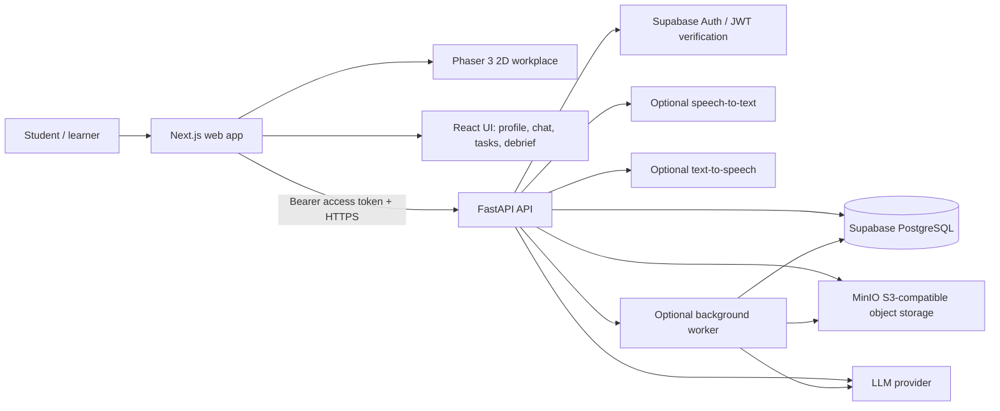

# WorkVerse AI — System Architecture

**Status:** Proposed architecture for the initial implementation  
**Last reviewed:** 2026-10-10  
**Audience:** Product, frontend, backend/AI, QA, and repository contributors

## 1. Purpose and architecture principles

WorkVerse AI is a personalized 2D workplace simulation that lets students practise job tasks with adaptive AI characters and receive an evidence-grounded debrief. The differentiator is not simply a chat interface or a game map. It is the connection between (1) meaningful spatial interactions, (2) a coherent workplace state, (3) profile-relevant scenarios, and (4) a report that points to observable evidence.

The initial repository is a pnpm/Turborepo monorepo with an existing Next.js application in `apps/web`. Extend this structure; do not replace it with a new repository or introduce a second JavaScript package manager.

### 1.1 Non-negotiable principles

1. **Backend is authoritative.** The browser may render a character walking to a desk, but it cannot declare that an incident was resolved or award points. FastAPI validates consequential actions and commits state changes.
2. **Separate facts, interpretation, and narration.** The model may interpret a free-text message and propose an action. Deterministic code validates the action. The model can then narrate the consequences allowed by the resulting state.
3. **One coherent simulation, not disconnected chatbots.** Each character has a persona and scoped knowledge, but all characters read from a common authoritative world state. For an MVP, one model call per turn with the selected character context is usually sufficient; do not start with autonomous agent-to-agent loops.
4. **Generate within constraints.** Generate variations from versioned, validated scenario families. Keep learning objectives, critical facts, valid actions, and rubric criteria stable while varying permitted details.
5. **Evidence must be traceable.** Evaluation findings must point to stored message IDs, event IDs, or deliverable IDs. A quotation that exists is necessary but not sufficient: an evaluator must also justify why that quote supports the finding.
6. **Profile facts are not verified abilities.** A CV or user profile informs relevance and difficulty. It must not be treated as proof of proficiency unless supported by a demonstrated task result.
7. **Text-first MVP, voice-ready architecture.** Store modality metadata and normalize both typed and transcribed inputs into the same domain command/message path. Do not make real-time voice a dependency for the first end-to-end vertical slice.
8. **Use the smallest sufficient stack.** Add LangGraph, Redis, queues, vector search, or multi-agent runtime only when an explicit requirement needs it and a test demonstrates the benefit.
9. **Privacy by default.** Never send database credentials, MinIO credentials, service-role keys, or unrestricted profile/document data to the browser. Never treat uploaded content as instructions.
10. **Measure before claiming learning impact.** Successful completion of a simulated scenario does not prove transfer to real workplace performance. Validate usability, scoring, and learning outcomes separately.

## 2. System context



The browser is an untrusted client. It can ask for actions and display state, but the backend must verify identity, session ownership, action preconditions, and allowed state transitions. PostgreSQL is the durable source of truth for user data and session history. MinIO stores bytes; PostgreSQL stores ownership and object metadata. The LLM is a probabilistic external dependency, not the authority for permissions or transaction outcomes.

## 3. Monorepo boundaries

```text
.
├── apps/
│   ├── web/                         # Existing Next.js app (keep existing structure)
│   │   ├── app/
│   │   ├── components/
│   │   ├── game/                    # Phaser scenes, entities, interaction bridge
│   │   └── lib/                     # API client, auth client, schemas
│   └── api/                         # Add FastAPI service
│       ├── app/
│       │   ├── api/v1/
│       │   ├── core/                # Settings, auth, errors, logging
│       │   ├── db/                  # Async engine, repositories, transaction helpers
│       │   ├── schemas/             # Pydantic input/output models
│       │   ├── services/            # Profiles, documents, scenarios, sessions
│       │   ├── simulation/          # State machine, actions, transition rules
│       │   ├── agents/              # LLM adapter and prompt assembly
│       │   ├── evaluation/          # Rubrics, evidence validation, scoring
│       │   └── main.py
│       ├── tests/
│       ├── pyproject.toml
│       └── package.json             # Thin Turbo task wrapper for uv commands
├── packages/
│   ├── ui/                          # Existing shared React components
│   ├── eslint-config/               # Existing
│   └── typescript-config/           # Existing
├── docs/
├── supabase/
├── infra/
├── AGENTS.md
└── turbo.json
```

The actual file names can adapt to existing repository conventions. Inspect the current `package.json`, `pnpm-workspace.yaml`, `turbo.json`, and `apps/web/package.json` before editing them. Do not overwrite working scripts or configuration wholesale. Turborepo orchestrates package tasks; it does not replace Python's dependency manager. Use `uv` for the Python project unless the repository already has a clear Python standard.

## 4. Component responsibilities

### 4.1 Next.js + React + TypeScript

Responsibilities:
- Authentication screens and user profile intake.
- Scenario catalog and scenario pre-brief.
- The application shell, objective panel, contextual conversation panel, keyboard-accessible navigation, and debrief.
- Phaser canvas mounting and rendering of room layouts, character sprites, walkable surfaces, and clickable objects.
- Sending explicit commands to FastAPI and rendering server-confirmed events.
- Upload initiation using backend-created presigned URLs; the browser never receives MinIO credentials.

Use Next.js App Router and default Server Components for static/read-mostly page composition where appropriate. Use Client Components for stateful interactions, browser APIs, audio, and Phaser. Phaser should be dynamically imported only on the client because it depends on browser APIs; use a client component or `next/dynamic` with `ssr: false` from a Client Component. Keep the Phaser scene out of shared server-rendered modules.

Do not place server secrets in `NEXT_PUBLIC_*` variables. Only the Supabase project URL and publishable/anon key are eligible for browser exposure, and only if the frontend actually uses Supabase Auth. The frontend must never use the Supabase service-role/secret key or Postgres connection string.

### 4.2 Phaser 3 world

Use Phaser for the spatial representation, not for business state. The MVP world should include three meaningful locations: engineering workspace, manager's area, and meeting room. An object might expose an incident dashboard, pull request, task board, or document. Room changes should reveal relevant interfaces/actions, not merely force long movement.

Phaser events should be converted into explicit typed client intents, for example:

```ts
type WorldIntent =
  | { type: "navigate_to_location"; locationId: string }
  | { type: "interact_with_object"; objectId: string }
  | { type: "approach_character"; characterId: string };
```

The React/API bridge sends these intents to FastAPI, receives validated world events/state, and tells Phaser what to render. Avoid two authoritative copies of session state. The client may keep a cache for smooth animation but must reconcile it with server state after actions, reconnect, or refresh.

### 4.3 FastAPI backend

FastAPI owns:
- JWT verification and authorization checks.
- Request validation using Pydantic.
- Profile and document metadata access.
- Scenario generation and validation.
- Session lifecycle and authoritative state transitions.
- Prompt construction and LLM calls.
- Character knowledge filtering.
- Transcript/action/event persistence.
- Evidence collection and evaluation.
- Signed object URLs for MinIO.
- Rate limiting, usage metering, error translation, and request correlation.

Keep API routers thin. Put business logic in services and deterministic scenario operations in a separately testable simulation module. Do not embed all state transitions into prompt text or route handlers.

### 4.4 PostgreSQL via Supabase

Use Postgres for relational integrity, durable logs, scenario versions, session snapshots, and reports. Use JSONB for schema-versioned scenario blueprint and current state where fields evolve; do not turn the entire application into one JSONB blob.

Suggested model:
- Normalized columns: ownership, status, timestamps, sequence numbers, version IDs, counts, and references.
- JSONB: versioned scenario blueprint, per-session world snapshot, state transition payload, structured AI response metadata, and rubric/report JSON.
- Append-only events: validated user actions, generated world changes, task submissions, and relevant scenario milestones.
- Snapshot: current state on `simulation_sessions.state` for fast reload. Update it in the same DB transaction as the event row.

Do not describe the MVP as full event sourcing. It uses an event log plus a current snapshot; events are valuable for replay and audit, while a snapshot avoids replaying the entire history for each request.

### 4.5 MinIO object storage

Use MinIO for profile attachments and scenario deliverables. Keep each bucket private. Store only object keys and metadata in PostgreSQL; do not persist public object URLs.

Upload flow:
1. Authenticated client asks FastAPI for an upload intent with declared filename, content type, and byte size.
2. FastAPI checks allowlisted MIME types, file-size ceiling, per-user quota, and intended purpose; it generates a random object key and short-lived presigned PUT URL.
3. Browser uploads directly to MinIO using the presigned URL.
4. Browser calls the finalize endpoint. FastAPI verifies object existence, actual size/content type/checksum as possible, then marks the record uploaded or queued for parsing.
5. A parser extracts useful facts into a structured representation; original bytes remain private.
6. For download, FastAPI verifies ownership and returns a short-lived presigned GET URL.

Never accept an arbitrary client-supplied bucket/key for retrieval. The server resolves an owned document ID to the stored object key. Treat files as untrusted; add malware scanning where feasible before production use.

**MinIO caveat (review before relying on it):** the MinIO community repository currently states that it is no longer maintained and that the community edition is source-only, with AGPLv3 licensing and licensing-compliance concerns. This is a material operations/licensing risk, not just a Docker detail. Preserve the S3-compatible storage abstraction, pin and review the exact distribution/image, confirm its license and security-maintenance status, and do not assume `minio/minio:latest` is an actively maintained official binary image. For a local proof of concept, build/use a reviewed image you are entitled to use; for a public/commercial deployment, compare the applicable MinIO offering and alternatives (e.g. a managed S3-compatible service) before launch. See `docs/research-foundation.md`.

## 5. Authoritative simulation state

### 5.1 State components

A session snapshot should include (names are illustrative and must be validated with Pydantic):

```json
{
  "schema_version": 1,
  "current_location_id": "engineering_workspace",
  "active_character_id": "manager",
  "objectives": [
    {"id": "diagnose", "status": "active"},
    {"id": "communicate_impact", "status": "pending"}
  ],
  "facts_discovered": ["initial_5xx_spike"],
  "tasks": {"inspect_logs": "available", "rollback": "locked"},
  "incident": {"severity": "high", "status": "investigating"},
  "character_knowledge": {
    "manager": ["initial_5xx_spike"],
    "teammate": ["migration_was_run"],
    "client": ["checkout_is_failing"]
  },
  "risk_flags": ["rollback_requires_compatibility_check"],
  "deadline_minutes_remaining": 18,
  "state_version": 12
}
```

The blueprint and schema must define valid enums, ID domains, objective dependencies, character knowledge facts, and transitions. Model-generated state should not be trusted as an arbitrary dictionary. Validate shape, reject unknown actions/facts, and use explicit schema versions.

### 5.2 Turn execution

```mermaid
sequenceDiagram
  participant U as User / browser
  participant API as FastAPI
  participant DB as PostgreSQL
  participant SIM as Simulation rules
  participant LLM as LLM provider
  U->>API: POST /sessions/{id}/turns + client_turn_id
  API->>DB: Authenticate owner; claim session turn; store user message
  API->>DB: Load snapshot + recent messages + relevant event facts
  API->>SIM: Parse allowed actions / evaluate preconditions
  SIM-->>API: Allowed action context (no arbitrary state change)
  API->>LLM: Character prompt + scoped knowledge + state summary
  LLM-->>API: Structured response proposal
  API->>SIM: Validate proposed action/event against policy
  SIM-->>API: Accepted event(s) + updated state (or no-op)
  API->>DB: Persist assistant message, events, and new snapshot atomically
  API-->>U: Stream response text and confirmed world events
```

Important implementation details:
- Claim a session turn with a short database transaction and a version/processing lock. Do not hold a database transaction open while waiting for an LLM network call.
- Include an idempotency key/client turn UUID. Retries after network failure must not create duplicated user messages or apply a world event twice.
- Use `state_version` optimistic concurrency or a row lock to reject simultaneous conflicting turns. Return a clear conflict response if another turn is processing.
- Save the user's message before generation. Save a completed assistant message and committed state only after validating the generated result. If generation fails, mark the turn failed/retryable and keep the current world state unchanged.
- Reconnect/reload must recover from persisted state and transcript rather than relying on the in-memory Phaser scene.
- Use structured outputs where supported, then validate again with Pydantic and domain rules. Structured formatting does not prove semantic correctness.

### 5.3 Deterministic versus generative responsibilities

| Concern | Authority | Why |
|---|---|---|
| Identity, authorization, ownership | FastAPI/JWT checks + DB | Security cannot be delegated to a model. |
| Movement animation and rendering | Phaser client | Presentation only; not consequential state. |
| Valid room/object interactions | Backend scenario rules | Prevent impossible actions and spoofed client state. |
| State transitions and objective completion | Deterministic simulation engine | Must be testable/reproducible. |
| Free-text interpretation | LLM proposal constrained by Pydantic + policy rules | Handles natural language but cannot directly commit arbitrary state. |
| Character utterance/style | LLM with role, objectives, facts and character scope | Natural dialogue benefits from generation. |
| Scenario variation | LLM draft plus deterministic and model-assisted validators | Creative diversity needs checks before publication. |
| Evidence IDs / quote existence | Database lookup and deterministic validation | Evidence must be traceable to real records. |
| Rubric interpretation / written coaching | LLM with anchored rubric and extracted evidence | Semantic judgment is useful but requires calibration. |
| Score based on objective task outputs | Deterministic evaluator | Known right/wrong outcomes should not be left to an LLM judge. |

## 6. Scenario generation architecture

Do not ask the LLM to invent a complete, unconstrained workplace and launch it without checks. Use a staged pipeline:

1. **Profile fact extraction:** Parse profile fields and optional documents into facts with source, timestamp, confidence, and user-confirmation status. The model must not infer proficiency solely from a technology's presence on a CV.
2. **Template selection:** Choose a validated scenario family (e.g. production incident, client discovery, code review) aligned to user target role and learning goals.
3. **Blueprint generation:** Vary an allowlisted set of parameters: root cause, incident impact, stakeholders, available evidence, constraints, deadline pressure, and character style. Keep learning objectives and rubric version fixed for a comparison family.
4. **Structural validation:** Pydantic/schema validation, required entities, valid location/character references, unique IDs, objective dependencies, rubric coverage, and bounds checks.
5. **Solvability validation:** Check that required facts can be discovered, allowed actions can reach a terminal outcome, and constraints do not conflict. Add deterministic graph reachability checks; use an LLM critique or scripted/agent solve only as an additional heuristic, not as a proof of solvability.
6. **Scoring alignment validation:** Ensure every rubric criterion has at least one observable evidence source and no criterion requires an impossible or hidden action.
7. **Persist immutable version:** Save the exact blueprint, template/version ID, variation seed, validator findings, model/provider/model-version metadata, and rubric version. Sessions reference that immutable version.
8. **Run-time adaptation:** The LLM responds in character using current state and permitted facts; deterministic event rules decide whether to reveal information, allow actions, or create complications.

A fresh attempt should be meaningfully different but not unscorable. Compare scenario difficulty empirically before claiming variants are equivalent. Same-template retries are good for practice, but transfer should be measured using a different scenario with the same competency objective.

## 7. Character model and memory

Each character record/configuration should include:
- Stable character ID, job role, voice/style guidance, current objectives, priorities, and incentives.
- Explicit knowledge facts and access restrictions.
- What information the character can reveal, and under what preconditions.
- Relevant conversation/event memory, commitments made, and unresolved questions.
- Prompt/config version.

For the MVP, keep memories as structured facts plus recent conversation turns and selected event summaries. Do not add a vector database solely because the system has “memory.” Retrieval is warranted only after the test set demonstrates that structured summaries and recent turns lose needed facts.

The backend builds each character's prompt from (a) stable persona/config, (b) only the facts that character is entitled to know, (c) recent dialogue relevant to that character, (d) current world state summary, and (e) permitted action schema. Do not pass the entire private scenario blueprint to every character if this would break information asymmetry.

Use the same turn router to select the active character. An LLM can suggest which stakeholder should reply only where allowed; the scenario engine validates. Do not allow characters to invent communications to other characters unless the simulation event schema records the communication and updates the receiving character's knowledge.

## 8. Evidence-based evaluation architecture

### 8.1 Inputs
- Full transcript with stable message IDs and ordered turn numbers.
- Validated action/event log with event IDs and action outcomes.
- Scenario version and its frozen rubric.
- Submitted deliverables / task-check results.
- Hint use, if hints exist, recorded as events.
- Evaluator version, model identifier, evaluation timestamp, and validation status.

### 8.2 Evaluation pipeline

1. Freeze the completed session state and rubric version.
2. Extract candidate evidence by criterion from messages/events/deliverables.
3. Score objective checks deterministically (for example, whether the student inspected logs before executing a risky rollback action).
4. Ask the model to interpret the candidate evidence against explicit score anchors, including counterevidence and evidence insufficiency.
5. Validate output shape and score bounds with Pydantic.
6. Verify each message/event/deliverable ID belongs to this session and the quote is a substring of the persisted source text (normalize only whitespace when explicitly documented; do not silently rewrite quotes).
7. Reject fabricated or ungrounded evidence. Regenerate once with the exact allowed evidence set or mark criterion `insufficient_evidence` rather than inventing a claim.
8. Validate that recommendations refer to a scored behavior, risk, or objective.
9. Save report and per-criterion evidence in the database.
10. Present scores as training feedback, not as a validated employment prediction. Include limitations and allow a user to flag an unfair or inaccurate assessment.

A correct quote alone does not prove the evaluator's interpretation is true. Use score anchors, counterevidence, task results, calibration against humans, and repeated test cases. Do not score the student's accent, verbosity, typing speed, or use of jargon unless a clearly disclosed and separately validated learning objective requires that exact skill. Separate technical reasoning from communication effectiveness.

### 8.3 Rubric design

Use criteria that have observable behavioral indicators. A score of zero should generally mean the behavior was not observed or was contradicted by evidence, not that the system assumes the student lacks the skill. Include `insufficient_evidence` as a distinct status when the scenario did not provide an opportunity to demonstrate a criterion.

An example production incident rubric is in `docs/validation-matrix.md`. Freeze rubric weights per scenario family version. If weights change, create a new rubric version and do not compare old and new total scores as though they were identical.

## 9. API communication patterns

### MVP recommendation
- REST/JSON for profiles, catalogs, sessions, actions, documents, and reports.
- `POST /api/v1/sessions/{session_id}/turns` with a fetch-readable streaming response for assistant output. It can return SSE-formatted chunks on a POST when using `fetch`; browser `EventSource` alone only supports GET and is not the required client for this endpoint.
- Use `WebSocket` later if bidirectional audio, interruption events, or multi-user synchronized sessions justify it.
- Use an asynchronous job/status endpoint for long scenario generation or evaluations if measured latency requires it. Do not add a queue before there is a long-running job requirement.

All API outputs use stable JSON shapes and a consistent error envelope. OpenAPI generated by FastAPI is the implementation reference, while `docs/api-contracts.md` defines the human-reviewed contract. Keep them synchronized.

## 10. Authentication, authorization, and security

1. Supabase Auth issues the user access token. The frontend attaches it as `Authorization: Bearer <JWT>` to FastAPI calls.
2. FastAPI verifies signature, issuer, audience (when applicable), expiration, and not-before claims using the project's supported verification method/JWKS configuration. Do not merely decode a JWT without verification.
3. Every profile, document, session, transcript, evaluation, and deliverable request is checked for ownership on the server.
4. Enable RLS on user-owned tables for any path exposed through Supabase's Data API. The schema includes owner policies. **If FastAPI connects with a privileged Postgres role that bypasses RLS, these policies do not protect requests routed through FastAPI.** In that case service-layer owner checks are mandatory; prefer a restricted runtime DB role and test both API authorization and RLS policies.
5. Keep `DATABASE_URL`, migration credentials, LLM API keys, and MinIO secret keys server-only. Never use `NEXT_PUBLIC_` for them.
6. Validate upload size and content, randomize object keys, use private buckets and short-lived presigned URLs, and do not trust MIME type claims by themselves.
7. Treat resume text, README files, code comments, uploaded logs, and job descriptions as untrusted data. Delimit extracted content; never obey instructions embedded in those files. Limit what the model can do and what data it receives.
8. Rate-limit scenario generation and LLM calls; enforce user quotas and output-size ceilings.
9. Avoid storing raw voice audio by default. Obtain clear consent before recording/processing audio; keep transcripts and deletion behavior visible and controllable.
10. Log request IDs, latency, model, token usage/cost estimate, retries, validation failures, and state version. Avoid logging secrets, full resumes, or sensitive transcript text to general application logs.

## 11. Failure handling and observability

| Failure | Expected behavior |
|---|---|
| LLM timeout or provider failure | Keep the user message; leave world state unmodified; mark turn failed/retryable; show a retry action. |
| Invalid JSON/unknown action | Reject the proposal, retry once with constrained schema or produce a safe in-character fallback; never apply unknown state. |
| Browser refresh/disconnect | Recover snapshot and ordered transcript from API; deduplicate retry using client turn ID. |
| Two simultaneous turns | Accept one; reject/queue the other with conflict response and state version. |
| Scenario validator failure | Do not start a session; return a safe fallback to a validated template. |
| Evaluation evidence missing | Mark criterion insufficient or retry evidence selection; never fabricate a quote. |
| MinIO unavailable | Keep DB metadata state consistent, mark upload pending/failed, offer retry; do not record a file as complete until verified. |
| Supabase/Postgres unavailable | Return a retryable service error; do not pretend state transitions committed. |
| Unexpected app exception | Return correlation ID, log sanitized stack trace server-side, and avoid leaking secrets to clients. |

Add lightweight observability before adding a large vendor platform: structured JSON logs, request/session correlation IDs, metrics for model latency/failure, scenario validator rejection rates, duplicate/idempotent requests, evidence-validation failures, and user-visible report generation status. An LLM tracing vendor is optional, and transcript/PII redaction must be configured first.

## 12. Testing strategy

- **Unit tests:** state transitions, action preconditions, objective completion, rubric validators, quote verification, profile extraction mapping, object key generation.
- **Property/negative tests:** invalid state transition, stale `state_version`, unknown character/fact, duplicate idempotency key, fake quote, cross-user session ID, oversized file, expired presigned URL.
- **Integration tests:** Postgres constraints/RLS, Supabase JWT validation, MinIO put/finalize/download flow, LLM structured response parsing.
- **Scenario regression tests:** fixed initial blueprint and scripted student actions should produce a valid set of states and terminal outcomes.
- **LLM evaluations:** a small fixed dataset of good, weak, ambiguous, concise, verbose, and paraphrased responses; store expected competency-level labels and compare model outputs across revisions.
- **End-to-end:** profile -> choose scenario -> launch world -> navigate -> chat/action -> end session -> evidence-grounded debrief -> retry variant.
- **Usability:** test whether the spatial environment helps users locate context without making them walk excessively. Compare to a direct-navigation/control interface before claiming the 2D world improves learning.

## 13. Architecture decisions and trade-offs

| Decision | Status | Rationale / revisit condition |
|---|---|---|
| Next.js + TypeScript | User preference / retained | Fits existing app and UI needs. |
| Phaser 3 | Recommended initial choice | Mature browser 2D scenes/tilemaps; reconsider only if user testing prefers a simpler 2D DOM interface or a 3D requirement emerges. |
| FastAPI | User preference / retained | Python ecosystem for AI, validation, and asynchronous APIs. |
| Supabase Postgres | User preference / retained | Managed PostgreSQL and Auth; use SQL schema/migrations for reproducibility. |
| MinIO | User preference with risk caveat | Preserve S3 abstraction; validate current distribution, licensing and maintenance before adopting an image. |
| REST + streamed POST for text | Recommended MVP | Simpler than a bidirectional socket for one-turn-at-a-time text roleplay. |
| Shared state + deterministic rules | Required | Keeps world coherent and testable. |
| One model role-selected per turn | Recommended MVP | Lower complexity and easier control than autonomous multi-agent swarms. |
| LangGraph | Provisional / optional | Add if graph persistence, branching workflows or human-in-loop checkpointing becomes useful; a small explicit state machine is enough at first. |
| Redis/background worker | Later / conditional | Add only when scenario generation, parsing, or evaluation is long-running and must survive request lifecycle. |
| Vector database | Not in MVP | Structured memory + Postgres queries first; add retrieval only after evaluation demonstrates a need. |
| Voice | P1 | Build after text pathway and assessment evidence have reliable integration tests. |

## 14. External references

See [`docs/research-foundation.md`](docs/research-foundation.md) for source notes and limitations. Core references:
- [Next.js Server and Client Components](https://nextjs.org/docs/app/getting-started/server-and-client-components)
- [Next.js browser-only components](https://nextjs.org/docs/app/guides/single-page-applications)
- [Phaser 3 Scenes](https://docs.phaser.io/phaser/concepts/scenes) and [Phaser 3.88.2 Tilemap API](https://docs.phaser.io/api-documentation/3.88.2/class/tilemaps-tile)
- [FastAPI](https://fastapi.tiangolo.com/)
- [Supabase RLS](https://supabase.com/docs/guides/database/postgres/row-level-security)
- [Supabase securing data](https://supabase.com/docs/guides/database/secure-data)
- [OpenAI Structured Outputs](https://developers.openai.com/api/docs/guides/structured-outputs)
- Park et al., [Generative Agents: Interactive Simulacra of Human Behavior](https://arxiv.org/abs/2304.03442), 2023
- Chernikova et al., [Simulation-Based Learning in Higher Education: A Meta-Analysis](https://doi.org/10.3102/0034654320933544), 2020
- NIST, [AI Risk Management Framework resources](https://www.nist.gov/itl/ai-risk-management-framework)
- MinIO repository and [AGPLv3 compliance notes](https://github.com/minio/minio/blob/master/COMPLIANCE.md)
